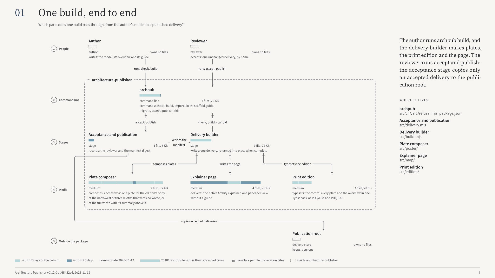

# Architecture Publisher

Architecture Publisher turns an explicit model of a repository's architecture
into a print edition and an interactive page, and checks that every file its
parts claim and its connections cite exists at one pinned commit.



_Plate 01 of the publisher's own edition, built by 0.13.1 from
[its model](https://github.com/HengYangDS/architecture-publications/blob/dev/publications/architecture-publisher/README.md)._

You write the model: the components, the connections between them and the
files that show each one, or you import a LikeC4 workspace. `archpub` reads
those files at the commit the model pins, lays each view out as a plate with
no overlaps, and delivers a PDF of one plate per view, a picture of each page,
a standalone page that walks through the system, and a manifest that binds
every byte to its inputs. A named reviewer accepts the delivery before it is published.

## Install

```sh
mise use -g github:HengYangDS/architecture-publisher
```

[mise](https://mise.jdx.dev) installs the release archive for your machine:
Linux and Windows on ARM64 or x86-64, or macOS on ARM64. It holds `archpub`
with its own Node.js and Typst, so it needs only Git. The
[how-to guides](docs/how-to.md#install-the-command) install it with Homebrew,
as an npm package or from the archive alone, and say how to take a release on
the day it is published.

## Quick start

```sh
archpub check model.json --repo ../my-repository
archpub build model.json --repo ../my-repository --out delivery
archpub accept delivery --reviewer "Your Name"
archpub publish delivery --to <publication-root>
```

`check` validates the model, reads every file it claims and cites at the pinned
commit and lays out every plate, without writing anything. `build` writes the
delivery. Only an accepted delivery is published, under
`<publication-root>/<model id>/<version>/`. The [tutorial](docs/tutorial.md)
builds a first work from an empty directory in about fifteen minutes.

## What it guarantees

- **The model, not the code, states the architecture, and the code backs it.**
  Each component claims the paths it owns and each connection cites the files
  that show it. A claim that owns no file or a cited file that is gone is
  refused, and `check --repo <checkout> --against <commit>` lists what moving
  the pin would change.
- **A plate never draws an overlap.** Cards sit on one lattice and every wire is
  horizontal or vertical; a wire through a card, a shared segment or a touching label
  rejects the layout, and a view no layout can draw is refused, never shrunk.
- **The same inputs give the same bytes.** The manifest records the digest of
  the model, every file read, every bundled supply and every file written;
  with `--repo`, which dates the edition by the pinned commit, the same model
  and version reproduce every byte on one platform.
- **A named reviewer accepts.** `accept` refuses a delivery that changed since it was
  built, and records who accepted it.

## Published works

Six works are published from models kept outside the systems they describe, in
[architecture-publications](https://github.com/HengYangDS/architecture-publications),
each in English and Chinese:

- [ETHOS](https://github.com/HengYangDS/architecture-publications/blob/dev/publications/ethos/README.md):
  how ETHOS turns official intent and fresh facts into proven repository
  change.
- [Architecture Publisher](https://github.com/HengYangDS/architecture-publications/blob/dev/publications/architecture-publisher/README.md):
  how a model becomes a print edition and a page.
- [AIGW Client Projection](https://github.com/HengYangDS/architecture-publications/blob/dev/publications/aigw-client/README.md),
  [Data Department Work Guidelines](https://github.com/HengYangDS/architecture-publications/blob/dev/publications/ddwg/README.md),
  [Film Kit](https://github.com/HengYangDS/architecture-publications/blob/dev/publications/filmkit/README.md)
  and the
  [OpenAI Responses Proxy](https://github.com/HengYangDS/architecture-publications/blob/dev/publications/openai-responses-proxy/README.md).

## With an agent

```sh
archpub skill
```

prints the agent Skill that ships with the installed version. It walks an agent
through agreeing on the reader's question, claiming files, planning views,
checking, writing the guide and building, and leaves acceptance to the reviewer.

## Documentation

- [Tutorial](docs/tutorial.md): publish a first work, step by step.
- [How-to guides](docs/how-to.md): install, import, write a guide, compose an
  overview, re-pin and hand a work to a reviewer.
- [Model reference](docs/reference/model.md): every field of an Architecture
  Model.
- [Operations reference](docs/reference/operations.md): commands, layout, the
  delivery and every refusal.
- [Glossary](docs/glossary.md): the words the publisher uses.
- [Product contract](docs/product-contract.md): inputs, outputs, quality floor
  and boundaries.
- Examples: the [Big Bank model](examples/big-bank/README.md) and the
  [LikeC4 shop workspace](examples/likec4-shop/README.md).

## Contributing

Bug reports, ideas and pull requests are welcome; [CONTRIBUTING](CONTRIBUTING.md)
explains how to report a problem, propose a change and check it locally. The
[changelog](CHANGELOG.md) records each release.

## License

Architecture Publisher is released under the [MIT License](LICENSE). The
bundled fonts, icons, measuring library, Archify and LikeC4 parser keep their
own licenses, which ship beside them.
