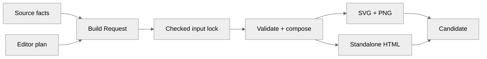
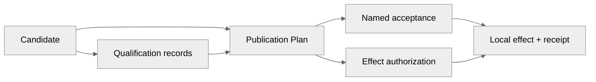

# Architecture Publisher product contract

## Product

Architecture Publisher turns explicit, source-bound system meaning into
understandable, verifiable, recoverable Architecture Editions for people and
Agents. It occupies the boundary between authoritative system knowledge and
reader-facing representations: it preserves semantic identity while allowing
static and interactive media to use different compositions.

The product does not discover truth by looking at code, screenshots, or tool
output. Source owners provide claims and provenance. Editions decide what a
particular audience must understand. Scenes express those decisions in a medium.
Renderers produce bytes. Qualification makes bounded judgments. Publication
performs explicit, recoverable effects. No downstream layer grants authority to
an upstream one.

## Promise

A published Edition answers three questions without conflation:

1. **What is asserted?** — exact claims, their plane, scope, condition,
   maturity, validity, provenance, unknowns, and contradictions.
2. **What must this reader understand?** — audience, questions, coverage,
   omissions, narrative, and reading order.
3. **What was actually delivered and checked?** — medium-specific artifacts,
   observations, qualifications, publication effects, and limits.

The promise is not automatic architecture inference or automatic beauty. It is
preserved meaning, explicit editorial judgment, independently composed media,
and evidence that names exactly what it establishes.

## Semantic roots

The seven product values are:

| Value           | Owns                                                                                                      | Does not own                        |
| --------------- | --------------------------------------------------------------------------------------------------------- | ----------------------------------- |
| `Source Bundle` | Exact selected bytes, revision, location, and source authority                                            | Interpretation or acceptance        |
| `Claim Model`   | Typed meaning across intended, implemented, observed, governed, and published planes                      | Layout or permission                |
| `Edition`       | Audience, questions, required claims, omission policy, narrative, visual grammar, scenes, and obligations | Source truth                        |
| `Scene`         | Medium-specific hierarchy, geometry, routes, typography, and interaction                                  | Semantic identity                   |
| `Artifact`      | Exact emitted SVG, PNG, HTML, and supporting bytes                                                        | Its own qualification               |
| `Qualification` | Predicate-specific judgment over exact subjects, evidence, verifier, scope, and limits                    | General truth or reusable authority |
| `Publication`   | Authorized, recoverable installation of selected artifacts                                                | Rendering, intent, or acceptance    |

Claim Model is one admitted typed carrier, not a mandatory intermediate for
every native format. A native import index is a disposable source-bound
interpretation, not an eighth editable authority. Selected evidence precedes
checked meaning, Edition, Scene, and Artifact; Qualification binds exact
subjects across that chain, and Publication requires separate authorization.
Every durable value has one semantic owner. Derived views remain rebuildable.
A contradiction or unrepresentable meaning fails closed; it is not hidden by a
layout choice, compatibility alias, or optimistic inference.

## Inputs

The generic compiler consumes four explicit roles, not necessarily four
separately authored files:

1. **Selected source evidence** — exact native files or a Source Bundle with
   provenance, source identity, and revision.
2. **Semantic interpretation** — a checked native-format index, an attributed
   projection, or the historical Claim Model v2, bound to selected bytes with
   supported meaning and loss explicit. Native sources do not require a tracked
   duplicate Claim Model.
3. **Edition** — audience, reader questions, required claims, explicit
   omissions, narrative, visual grammar, independent scenes, and qualification
   obligations.
4. **Build Request** — selected source and Edition meaning, optional Providers,
   requested media, and toolchain. The selected-input build invocation selects its
   Candidate output directory separately; historical v1 plans retain their
   original output-field meaning.

An Edition Provider is an optional transport boundary owned by its designated
source or editor. Declarative delivery selects exact portable bytes; executable
delivery prepares exact selected bytes through one independently installed,
bounded child-process export. A Provider may supply an attributed derived
projection, but cannot make it source-endorsed or validated merely by returning
it. Both modes converge before semantic compilation. Providers do not compose
scenes, qualify artifacts, authorize effects, or own publication.

In the selected-input Edition Project, a source selection's question
list is the sole authored source-assertion record; its assertion ID is derived
from the selection ID. A questionless selection can support an attributed
editorial assertion but has no source-visible obligation of its own. Ordered
medium views own page order, and each view owns its question order. This
authoring subtraction does not alter historical Edition v1 contracts or merge
source truth with editorial judgment.

Editorial visual groups are optional. A selected Claim Model structure without
groups uses the same bounded, selected Dagre geometry supply as grouped
structure, but gains no invented group or membership claim. A declared group
remains exact editor-owned meaning; the compiler never silently creates one to
make its layout implementation convenient. Infeasible flat or grouped
composition fails without losing selected entities, relations, or qualifiers.
One neutral raw entity/relation view uses the same question-led complete figure
as multiple views. A selected upstream authored view without editorial groups
retains its distinct source-view composition. A neutral layout may try
alternative coordinates but must preserve selected meaning, caption clearance,
and declared grouping. Its current geometry strategy belongs to the active
design and tests, not this product contract.

The editor's `questions[].text` is a reader-facing prompt, not an executable
query. Publisher checks finite ID links from each selected question to source
assertions or explicit limits and to visible medium carriers. These checks do
not establish that a natural-language question is substantively answered, that
the source assertion is true, or that its presentation is adequate. Those
judgments remain with the named source owner, editor, and accepter.

The selected-input authoring contract accepts exact references, not a
query or transformation field without an implemented consumer. Such fields
fail validation rather than promising a Candidate that cannot be built.
Editorial assertions preserve their proponent and basis without becoming
source-approved transformations.

A Git repository, SDD tool, documentation service, code graph, telemetry store,
or project-specific schema is a possible upstream source, not a hidden compiler
dependency. Its adapter emits an admitted source-bound interpretation or
attributed projection with loss, uncertainty, and provenance explicit; it need
not duplicate the source as a Claim Model. Manual authoring of admitted standard
values is also valid.

## Processing

The selected inputs meet in one Build Request. Direct reads and selected
Providers converge on a checked input lock before semantic selection and
medium-specific composition. Neither medium is made from the other.



The qualified Edition route then binds the exact Candidate and applicable
predicate records into a Publication Plan. The named accepter and local effect
authorizer make separate decisions against that plan; neither decision is
inferred from build or qualification success.



These diagrams show value and decision dependencies, not CLI invocation order.
The raw paired-file route has narrower integrity-only obligations. Adapters
cannot grant source authority; Editions cannot change claims; scenes cannot
change meaning; renderers cannot add product claims; qualification cannot
manufacture acceptance; and publication cannot infer intent.

Bounded file input and strict protocol decoding establish only checked bytes
and shape. Source Bundle identity and source claims remain separate, and an
independent editor can use those byte operations without becoming a source
authority.

Only reading contexts declared by the Edition editor enter acceptance. A
browser resize or exploratory screenshot does not create another Edition,
device target, or approval obligation.

## Outputs

The output is not merely a PNG or HTML file and not every generated directory is
a publication. The product distinguishes:

- **Edition Candidate** — exact selected input lock, Edition, scene, renderer
  supply, and artifact identities; historical Claim Model inputs retain their
  own identity. It is rendered but not thereby qualified.
- **Qualification Set** — non-compensating semantic, coverage, geometry,
  browser, accessibility, installed-use, recovery, and human-review judgments
  over exact subjects.
- **Publication Plan** — selected qualified bytes, destinations, authorization,
  preservation, replacement, and recovery state without performing the effect.
- **Edition Publication** — reader artifacts plus exact build, qualification,
  publication, and recovery identities after the authorized effect.

Reader-facing artifacts normally include an independently composed static
SVG/PNG pair and one standalone interactive HTML document. Their manifest and
receipts explain what the bytes mean, where they came from, which checks passed,
which limits remain, and which effect occurred. Installation, hosted
availability, and release are separate claims.

Reader media explain selected architecture; they are not build-diagnostic
reports. A static figure shows the Edition's reader-question limits and the
source-status qualification needed to prevent a stronger interpretation.
Method, dependency-closure, and replay limitations remain exact in the
Candidate and its inspection evidence, rather than being printed as raw codes
on the figure. Moving a method limitation out of the figure never makes it
pass: if unsupported source meaning prevents a promised answer, compilation
must reject that answer before Candidate emission.

## Product identity

The product is **Architecture Publisher**. The package is
`architecture-publisher`; the public command is `archpub`; the canonical
repository is `architecture-publisher`. ETHOS, AIGW, and the product itself are
Editions or adopters. `ETHOS Architecture` names the ETHOS publication, never
the publishing product.

Historical releases retain the identities under which they were published. The
current runtime does not retain aliases or a second mutable product identity.

## Product boundary

Architecture Publisher is downstream of source truth and upstream of reader
artifacts.

- ETHOS owns governed repository evolution, authority, lanes, proof, CAS effects,
  and Attestations.
- OpenSpec and other SDD carriers own accepted intent in their source domains.
- Git owns object identity, history, refs, and repository-local CAS.
- Code graphs and telemetry supply observations, never product intent.
- Skills supply replaceable methods, never lifecycle or acceptance authority.
- Archify, SVG, rasterizers, and browsers are rendering or observation backends.

Architecture Publisher may reject, explain, project, qualify, install, replace,
and recover an Edition. It may not authorize a source-system transition or
silently write feedback into a source authority.

The Architecture Publisher repository is a development and conformance
workspace. Its distributable product contains generic contracts, renderer
capabilities, qualification, publication, and the `archpub` composition root.
It also owns the source-owned live Edition for Architecture Publisher itself,
because that Edition describes this source product.

A live Edition belongs to its designated editor, not automatically to the
repository whose architecture it describes. ETHOS and AIGW retain authority
over their native meaning, any adapter they elect, authorization, acceptance,
and release. Each may designate an internal or external Edition editor. An
independent or cross-source editor may work from exact read-only source bytes
without changing the source repository or acquiring authority over its
assertions. Official endorsement of selected source scope requires an explicit
source-owner decision; the designated accepter separately accepts the exact
Candidate. Publisher does not require source-repository changes or an ordinary
source-product CI gate for independent analysis. Neither first-party path
requires a duplicate editable Claim Model when admitted native inputs suffice.
Publisher may keep compact immutable fixtures and receipts, but not a second
mutable implementation after an adopter accepts its canonical Edition.

A selected-input Edition's title and summary are the editor's words, not source
assertions. Both media identify that editor and state that the diagram itself
does not evidence source endorsement. The exact Candidate still needs its own
review and acceptance.

New authoring selects one versioned Build Request with direct inputs and optional
`architecture.edition-provider/v2` manifests. Each Provider transports exact
native, derived, or Edition bytes declaratively or through one selected
executable package; multiple Providers may contribute distinct namespaces.
Historical Provider v1 remains accepted for replay of exact prior inputs; it is
not the new-authoring contract. Both versions enter through `archpub edition build`;
there is no Provider command tree, registry, or ambient discovery. Ordinary
execution has no adjacent checkout dependency, repository-name dispatch,
local-user path, or implicit source discovery. The source repository's native
lifecycle authorizes its own changes; Publisher qualification and release
consume exact outputs without copying that lifecycle or its progress ledger.

Candidate and publication provenance keep `subject`, `producer`,
`authorizationOwner`, and `custodian` distinct. Provider conformance does not
grant acceptance, publication, independent verification, or source-product
authority.

## Construction discipline

The implementation has two independently authored inputs: selected source
meaning and the Edition's reading choices. They meet at Scene composition;
renderers consume Scenes, qualification inspects exact emitted artifacts, and
publication requires a separate authorized effect. Source interpretation
cannot author the Edition; the Edition cannot change source meaning. Neither
supplies acceptance or authorization.

Adapters point inward to public contracts. Editions depend on public contracts
and selected renderers. Generic modules never import a concrete Edition.
Renderers never infer semantic truth. The CLI is a composition root, not a
domain owner.

Abstractions must reduce the number of concepts a consumer needs to understand.
No `core`, `common`, `shared`, `utils`, `legacy`, or compatibility owner is
created without a demonstrated, independently testable responsibility.

## Media

Static and interactive publications are sibling projections. They share source
and Claim identities but not coordinates, DOM, page shape, layout constraints,
or acceptance evidence.

- Static composition optimizes one-frame causal comprehension, stable print-scale
  typography, vector geometry, and high-resolution raster delivery.
- Interactive composition optimizes a complete first-screen overview, focus,
  trace, source inspection, progressive disclosure, and complete mechanism views.

Neither medium is generated by capturing or serializing the other.

## Quality

`faithful`, `intelligible`, and `restrained` are non-compensating gates.

- **Faithful**: visible claims are source-bound; planes and uncertainty are not
  collapsed; required meaning is covered; limits are explicit.
- **Intelligible**: purpose and causal spine are immediate; hierarchy, grouping,
  routes, and detail views answer named reader questions.
- **Restrained**: proportion, typography, whitespace, rhythm, color, and motion
  support meaning without decorative noise.

Executed machine checks reject defects within their selected semantic,
geometry, browser, accessibility, installation, and recovery scopes. A skipped
check supplies no evidence. Human review judges perceptual hierarchy and
character for an exact artifact digest. Neither substitutes for the other.

## Evolution

An exact semantic change produces conservative obligations:

```text
source delta
-> affected claims
-> affected Editions and scenes
-> rebuild
-> semantic and medium verification
-> human review when required
-> explicit acceptance
-> publication
```

Unknown dependencies broaden review. Changed artifact bytes invalidate their
prior qualification. Generated artifacts are never authoring inputs. Persistent
graph storage, incremental query runtimes, and general constraint solvers remain
out until a named adopter proves an irreducible need and lower ownership cost.

## Product modes

- A **structural Edition** promises deterministic source binding, declared
  coverage, and technical readability.
- A **flagship Edition** additionally promises deliberate art direction,
  reader-tested hierarchy, accessibility, and exact-artifact human acceptance.

The minimal structural examples remain useful protocol demonstrations. They are
not the public self-portrait and must not be presented as flagship work.

## Completion

A release is complete only when exact source, package, static and interactive
artifacts, qualification, installed replay, recoverable publication, signed tag,
remote readback, and declared human acceptance are independently accounted for.
Local existence, a clean tree, a green test suite, or a package upload proves
only its own boundary.

## Authority Matrix

"Source product" means Architecture Publisher for its self-Edition, ETHOS for
ETHOS, and AIGW for AIGW. This matrix governs Publisher's interfaces, not
another product's internal policy. One party may fill several roles, but
co-location never transfers authority; a cross-source editor, accepter and
custodian need not be any source product. Archived proposal matrices remain
historical evidence, not a second active rule.

| Concern                          | Authority                                          | Publisher role                                              | Not implied                                             |
| -------------------------------- | -------------------------------------------------- | ----------------------------------------------------------- | ------------------------------------------------------- |
| Native meaning and source claims | Source owner; named claimant per assertion         | Bind exact evidence and declared import loss                | A selected statement is not thereby implemented.        |
| Editorial claims and Edition     | Edition editor                                     | Validate selection and compose reader works                 | Editorial judgment is not source endorsement.           |
| Provider interchange             | Publisher                                          | Validate one versioned input protocol                       | The protocol does not choose a source package.          |
| Provider selection               | Build Request author                               | Bind exact inputs; retain separate declared claimant/editor | Selection grants no source truth or effect.             |
| Scene, rendering and Candidate   | Publisher                                          | Derive independently composed media                         | Structural output is not flagship approval.             |
| Predicate observations           | Predicate-specific verifier                        | Bind exact Qualification subjects and limits                | One PASS does not establish another predicate.          |
| Candidate acceptance             | Designated accepter under product/editorial policy | Bind judgment to exact Candidate and policy                 | A green build is not approval.                          |
| Release authorization            | Designated release owner                           | Record selected release subject and decision                | Accepted media do not publish themselves.               |
| Repository and Git effects       | Repository policy; Git owns objects and refs       | None without a separate source-owned adapter                | Publisher owns no Work Lane, CAS or ref transition.     |
| Local file publication           | Target policy's designated authorization owner     | Plan, apply and recover exact filesystem effect             | Local install is not Forge release or target authority. |
| Artifact custody and retention   | Selected custodian                                 | Record producer and effect receipts                         | Output need not enter source Git or off-host storage.   |
| Feedback to source intent        | Each affected source owner                         | Propose an attributed, source-bound finding                 | No silent writeback.                                    |

These are modules and data contracts, not services, a graph database, an event
bus or another governance kernel. Source adapters, backends and skills remain
replaceable behind explicit interfaces. Ordinary installed use does not require
Git, OpenSpec, ETHOS, a neighboring checkout, personal HOME or agent credentials.
Explicit source replay and development governance have separate prerequisites.

## Meaning before representation

Assertions retain subject, relation, object, direction, condition, quantifier,
scope, maturity, provenance and permitted aggregation. Every required assertion
needs a readable carrier; every visible claim needs a source. Counts and labels
alone do not establish equivalence. Code reachability cannot establish intended
architecture or deployed behavior.

The transferable discipline is attributed meaning, exact selection, bounded
derivation, predicate-specific evidence, and authorized effects, not a shared
domain ontology or a requirement to use this compiler. A selected Claim Model
relation can answer a structural reader question as source-reported topology;
its qualifiers remain visibly source-declared fields. Without a selected typed
claim, that relation receives no claim plane, validity, maturity, implementation
evidence, or typed-claim coverage. A narrower medium must disclose its scope and
earn its own acceptance rather than borrow another medium's claims.

## Minimum independent product

An installed CLI accepts explicit file input, typed diagrams and authored SVG;
it renders, verifies identities, packages selected files and installs/replays
an authorized pair through public commands. Non-ETHOS use must survive removal
of ETHOS edition/integration modules. Raw file publication establishes integrity
and controlled filesystem effects only; a qualified Edition additionally
requires its selected semantic and medium-specific evidence.

Dependencies must be declared, pinned and independently obtainable. Paths in
portable inputs are explicit and relative to their owning descriptor; installation
plans deliberately bind exact resolved targets. Never search sibling repositories
or borrow developer credentials. Source execution is opt-in and identity-bound.
Font redistribution requires its license; unchanged backend licenses stay bundled.

Demonstrate topology and conditional lifecycle examples, real membership/edge
updates, both media, relocation, empty HOME/PATH, offline installed use and explicit
temporary deployment/recovery. These bounded examples do not prove arbitrary
domains, universal platform support, automatic composition or browser acceptance.
The public paired installer retains two named slots and a shared-parent constraint;
arbitrary target cardinality is not an implied capability.

## Quality: faithful, intelligible, restrained

Semantic fidelity, complete required mechanisms, readable typography, no unintended
overlap/clipping, correct connected endpoints and truthful scope are hard gates.
No weighted aesthetic score can compensate for their failure. Among feasible
candidates, optimize hierarchy, alignment, reading flow, balanced canvas use,
spacing and routing burden. Measure actual glyph envelopes and stroke/arrow
geometry; generator bounding boxes alone are insufficient.

Use restrained color, contrast, scale and intentional negative space. Irregular
shapes and decorative curves are not evidence of elegance. Philosophical intent
belongs in coherent architecture and composition, not meaningless labels. The
Edition editor owns language and copy choices; renderers must not invent them.
Do not add version badges, debug counters, diff counts or vendor plate labels.

Geometry, source coverage, painted browser output, interaction, human visual
acceptance, installation and hosted delivery are separate evidence scopes. New
HTML bytes cannot inherit old browser approval. Inspection does not manufacture
authorization; a passing parser is not an observed execution.

## Sustainable regeneration

The accepted edition is frozen; recovery must reproduce it exactly. A new candidate
must be allowed to produce new bytes without first matching old output hashes.
Stable semantic identities survive harmless label changes; split/merge/rename
mappings require explicit source evidence, never guessed identity substitution.

1. Keep explicit candidate inputs separate from accepted-output locks in the same renderer.
2. Demonstrate one real source-owned semantic update across source, views, both media,
   qualification and candidate publication without changing generic code or
   editing generated SVG/HTML.
3. Exercise label growth, entity/edge insertion/removal, changed condition and
   direction, density growth, contradictions and unsupported relations. Reject
   unsupported meaning precisely while preserving the prior release.
4. Maintain conservative assertion-to-view-to-output dependencies. Unknown
   dependencies broaden verification, not optimistic cache reuse. Rebuild,
   recheck and reapprove are separate decisions.
5. Measure edited inputs, manual repositioning, rebuilt views, repeated checks
   and update time before adding incremental execution or speculative tooling.

Preserve reader mental maps with soft relative anchors; do not freeze coordinates
when meaning changes. Layout infeasibility must trigger explicit regrouping or
detail views, not silent omission or unreadable type. A new visual grammar may
require a bounded adapter; effortless arbitrary redesign is not promised.

Candidate preparation binds explicit authored text sites and complete-value
source identities. Checked preimages prevent stale edits, and a complete page
permutation preserves the declared interactive views while allowing explicit
reading order. The refresh example uses this same contract. Unsupported
topology requires an explicit bounded composition change, not guessed identity
substitution. A source-manifest change rebinds the Edition, invalidates
acceptance and publication, and requires fresh semantic plus installed-use
verification. It does not by itself imply that
scene geometry changed; changed or unrepresented meaning determines the affected
scenes. Automatic aesthetic optimization is not established by this increment.

The shared semantic compiler admits one v2 Claim Model: a finite typed
vocabulary, complete JSON qualifiers, byte-bound provenance, explicit planes,
conditions, scope, maturity and validity, plus opaque claims whose dependency
coverage remains unknown. A source-owned adapter using this model preserves
source extensions and invokes this one comparison owner. It does not add a
second diff engine, accept the retired v1 document at runtime, or infer
semantic equivalence.

Claim Model comparison reports meaning change only. Edition evolution then uses
the complete before/after Editions as the sole scene-dependency authority. It
propagates changed meaning through required claims, explicit omissions, static
composition and interactive scenes, broadening work when coverage is unknown or
meaning is unrepresented. Its result keeps `rebuild`, `semanticVerification`,
`mediumVerification`, `humanReview`, `acceptance`, and `publication` as six
separate obligations. Compilation executes none of them. Explicit rename,
split, and merge records lineage, not equivalence or inherited proof.

## Replacement is not replay

Recovery resumes its exact operation; a different edition requires an explicit
replacement selection. The same installer derives ownership from the prior plan,
not its broad preserved-file inventory. Replacement binds actual managed preimages,
preserves unknown files, refuses modified/missing owned files and retains bounded
rollback material through the existing journal and local rename boundaries.
Verify successive editions, no-op updates, dropped managed files, foreign edits,
interruption at either target and recovery. Never disable collision protection
or delete a destination to make an upgrade pass.

## Publication, storage and completion

Git holds source, small authored inputs, specs and locks. Releases link exact
reader assets. Qualification packages hold required scoped evidence; renderer
source has its own reproducibility boundary. Reuse unchanged packages, not one
package per operation. Predecessor history remains local, not a permanent remote
dependency. Remove only classified disposable work after checking consumers.

Source acceptance, main promotion, signed tags, Release entries, downloaded bytes,
clean-source restoration, actual installation and lane retirement are distinct
completion boundaries. A source push or package upload proves none of the rest.
