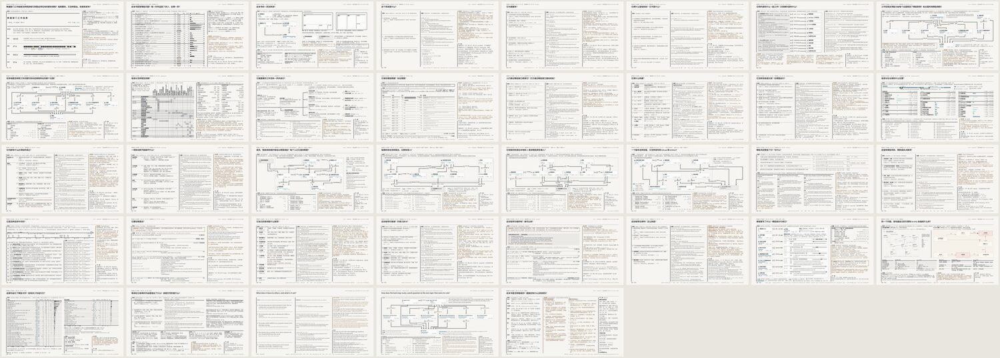

# The figure language of the edition: a map

A research page. It maps what was studied, drawn and decided about how the print edition draws a work, dimension by
dimension, and where each piece of that material lies. It decides nothing; the decisions that rest on it are in the
design of the Change `record-the-figure-language-and-its-end-state` and are named under "What follows".

## Question

On 2026-11-13 the owner asked for the dimensions of the design and the choices under each:

> 「我需要一个 full picture」

On 2026-11-17, between 00:52 and 01:01, the owner asked again, in these words among others:

> 「关于线型、不同维度、颜色、各种样式、风格、构图以及其他各方面，前序上下文中有很多讨论，怎么都损失掉了么？你到现在都没有呈现一个总结和全景」
>
> 「而且，我提过历史，现状和规划，提过很多其他方面的考量。为何到现在都没有一个全面的整体回应？」

Glosses, made for this page: "I need a full picture." "On line styles, the dimensions, colour, the styles and
compositions and every other aspect there was much discussion earlier in the context; has it all been lost? To this
day you have not presented a summary and a panorama." "And I have spoken of history, the present state and plans,
and of many other considerations. Why is there still no complete answer to the whole?"

Which dimensions does the edition's figure language have; what was studied and drawn for each; what does the
product draw today; and why was the earlier material not at hand when later work was done?

## Short answer

- A work is shown in three layers with three owners: what it says (its author), how a figure is drawn (the
  publisher), and in which form and medium it is delivered (the publisher, chosen by the caller).
- The figure language has nine dimensions: the part, lines, evidence layers, composition, carriers, the key and the
  reading page, palette, style, and type and page. Each has prototypes; the product draws one composition, a part as
  a strip or as a card, two evidence layers, four palettes and one style.
- Beyond structure plates the product draws nothing of its own: a work's overview page is placed by its author by
  hand, and history, plans, change, mechanism and a part opened have no figure.
- None of the material was tracked. It lay in ignored directories and in a handoff file, and the queue's items named
  none of it; later work began from the latest remark and redrew what existed.

## What was read or measured

All read directly and whole on 2026-11-17 unless marked. Paths under `build/runtime/work/` are ignored and local.

| Source                                                             | What it is                                                                                                      | Read                                  |
| ------------------------------------------------------------------ | --------------------------------------------------------------------------------------------------------------- | ------------------------------------- |
| The ledger of the owner's typed messages, 2026-10-26 to 2026-11-17 | 775 entries by 02:11:24 of the last day, extracted from the session records by script                           | whole                                 |
| Static-picture study of 2026-11-01                                 | Three research passes on one picture of a whole system; now [its own page](static-architecture-pictures.md)     | whole                                 |
| Handbook design of 2026-11-07                                      | What a work answers: twelve concerns under three lenses, three states, genres, depths, a reader exam            | whole                                 |
| Proposal of 2026-11-11                                             | The strip drawing, three dyes, four compositions chosen by a view's shape, the seal, distribution               | whole                                 |
| Overview and committee of 2026-11-13                               | Four dimensions with twenty prototypes; six reviewers' recommendation of five dimensions                        | whole                                 |
| Roadmap committee of 2026-11-14                                    | Carriers, one anatomy, one value table, eleven invariants of marks; its framing by statements was later dropped | sections 1 to 3; the rest by headings |
| Style research, rounds 3 to 5, of 2026-11-15                       | Thirty-three prototypes in ten territories, the set kept, decisions D1 to D7                                    | rounds 4 and 5 whole; round 3 in part |
| The hand-set sample book of 2026-11-15                             | Its page plan and its 37 pages                                                                                  | the plan whole; every page looked at  |
| The edition-forms committee of 2026-11-15                          | The chair's ruling; recorded in [its own page](edition-forms-committee-2026-11-15.md)                           | the ruling whole                      |
| The queue Change of 2026-11-16 and the contract                    | `order-the-queue-by-the-figure-language`; `docs/product-contract.md`                                            | whole                                 |
| The product at `dev`, commit `fedb474e`                            | `src/house.json`, `src/model/schema.json`, the model reference, the specification of the overview page          | the parts named                       |

Round 3's notes were read in part by the holder; they are recorded whole, by a reader who read all ten, in
[Prototypes of the edition's figures](figure-prototypes.md).

Measured on 2026-11-17:

- **The research home.** `docs/research/` on `dev` held eight pages, on letter height, text on projected pages, the
  layout of text pages, tidiness, PDF links, the committee of 2026-11-15, room-size fit and the second proof. None is
  about a composition, a part, a carrier, a palette or a style. Seven earlier pages and 22 captures, of September
  2026, were removed on 2026-11-14 (commit `ef5fe6e0`) as describing designs later releases replaced; they were not
  read again for this page.
- **Inputs that state positions.** `src/model/schema.json` holds no property of position, order or size. The
  twelve guides of the six published works hold no coordinate. The twelve overview compositions (six works, two
  languages) have 127 to 152 lines each, of which 66 to 85 carry a value in points: every line, ring and word is
  placed by its author.
- **One work as the product builds it.** The Chinese edition of the work on ETHOS, built at `fedb474e` with nothing
  retouched: 14 pages. The title page and the contents are set by the publisher; page 3, the overview, is the
  author's hand-placed composition; pages 4 to 14 are the eleven structure plates the publisher draws. Over the
  eleven plates the manifest records 17 crossings and 6 route defects; five plates are set at the smallest of the
  five type steps, one plate omits its view's summary, and the build warns four times that a count of cited files
  touches another mark.

Measured on 2026-11-16, and taken from the holder's records of that day:

- Of the 82 plates of the six works in two languages, 63 miss at least one of the four balance gates (blank share
  59, blank band 28, holes 27, centre 1); a miss is recorded and the plate is delivered.
- The room to the right of a plate's title is free on all 82 plates, at least 776 pt wide in Chinese and 608 pt in
  English, and at least 95 pt high.
- The strip's length is the fact `owned-bytes`: the bytes of every file a part owns, of any type. In the work on a
  documents repository 92.4 % of those bytes are Markdown and none are program source; in the other five works 89 to
  100 % are program source. The words the product sets for it say "the code a part owns", in five languages, since
  2026-11-13.
- A part drawn as one card with its strip, on the 17 Chinese plates of two works, against strips: crossings 26 to
  38, route defects 22 to 30, and plates at a larger type step fewer. With a caption that may break in two lines, no
  plate of the one work it was measured on is set a step smaller than with the product's card marks, and one is set
  a step larger.

## Findings

### Three layers

| Layer           | Owner                               | What it holds                                                                                                                                                                                 |
| --------------- | ----------------------------------- | --------------------------------------------------------------------------------------------------------------------------------------------------------------------------------------------- |
| Content         | the work's author                   | What a work answers: its positioning, top-level design, mechanisms, data and interfaces, stack, repository structure, start and change, verification and release, decisions, direction, terms |
| Figure language | the publisher                       | The part, lines, evidence layers, composition, carriers, the key and the reading page, palette, style, type and page                                                                          |
| Form and medium | the publisher, chosen by the caller | Landscape pages for presenting, portrait pages as a booklet, the page in a browser, the data and the reader file; languages; acceptance and its seal; distribution                            |

The division is the holder's reading. Four of the dimensions (composition, component, style, tone) are the owner's
frame of 2026-11-13; evidence layers were added by the committee of that day; carriers follow the owner's words of
2026-11-07 and 2026-11-15.

### The dimensions, with what exists

| Dimension                    | Studied and drawn                                                                                                                                         | In the product at `fedb474e`                                                                  | Queue item            |
| ---------------------------- | --------------------------------------------------------------------------------------------------------------------------------------------------------- | --------------------------------------------------------------------------------------------- | --------------------- |
| The part                     | Strip and card (2026-11-11 to 13); one anatomy in three levels (2026-11-15); the joined card measured on 17 plates (2026-11-16)                           | Strip or card, one or the other; all six works use strips                                     | `composable-parts`    |
| Lines                        | A table from meaning to channel (2026-11-14)                                                                                                              | One table: hub lines twice as heavy, planned dashed, retired dotted, the boundary dash-dotted | with `compositions`   |
| Evidence layers              | Age, citations, revisions, notes, strength, coverage (2026-11-13)                                                                                         | Age and citations                                                                             | `carriers`            |
| Composition                  | Four compositions chosen by a view's shape, tallied over 41 views (2026-11-11); five (2026-11-13); matrix on a page (2026-11-15)                          | One, the layered grid                                                                         | `compositions`        |
| Carriers                     | Chronicle, kept and changed, running order, solid and hollow, whereabouts, crossings, footprint, course, rules, accounts, part plate, detail (2026-11-15) | The author's overview and the structure plates                                                | `carriers`            |
| The key and the reading page | The sample book's page on how to read a page (2026-11-15); four designs of a key and a guide page (2026-11-16)                                            | A key of at most two lines on each plate                                                      | `composable-parts`    |
| Palette                      | Sixteen palettes, validated (2026-11-13)                                                                                                                  | Four built in, and an author's own; no work names one                                         | `palettes-and-styles` |
| Style                        | Monograph, drawing set, notebook (2026-11-11 to 13); nine page languages, of which Handoff was taken (2026-11-15)                                         | One                                                                                           | `palettes-and-styles` |
| Type and page                | Three reading levels in one picture (2026-11-01); sizes by viewing distance (2026-11-15 and 16, withdrawn)                                                | A page of 1600 × 900 pt, no figure text under 14 px, five type steps                          | `compositions`        |
| Form                         | Landscape for presenting and portrait for a booklet (the owner, from 2026-10-28)                                                                          | Landscape                                                                                     | `portrait-edition`    |
| The page                     | Whether Archify is used to the full (the owner, four times from 2026-11-01)                                                                               | Four to nine Archify diagrams a work; not measured against what Archify offers                | `page`                |

What each prototype drew, on which data, and why it was kept or cut is in
[Prototypes of the edition's figures](figure-prototypes.md).

### Why the material was not at hand

Four turns away from the figures are in the records, each after material that was then left where it lay:

| Date       | What had been made                                                            | What was built next                                                                             |
| ---------- | ----------------------------------------------------------------------------- | ----------------------------------------------------------------------------------------------- |
| 2026-11-11 | Four compositions chosen by a view's shape, which the owner approved          | Releases 0.13 and 0.14 with strips, palettes and the seal; no composition                       |
| 2026-11-14 | A table of lines; the owner's question whether card and strip must exclude    | A queue ordered around statements with evidence                                                 |
| 2026-11-15 | Thirty-three prototypes and a sample book of 37 pages                         | Layouts for pages of text, tiers of type sizes, a booklet of 189 pages of statements            |
| 2026-11-16 | A queue ordered by the figure language, which set the sample book aside whole | A joined card, a key and a reading page begun from nothing, with an untrue word for the measure |

The sample book's page 3 of 2026-11-15 already drew the joined card and the reading page, and named the strip's
measure as bytes. It was not looked at on 2026-11-16.

After the sample book was sent, on 2026-11-15, the owner spoke of pages of text, of what the edition is for, of
tidiness and of the two forms. No page-by-page verdict on its figure pages was asked for. What became of each page:

| Pages                                  | What                                                    | Where it goes                                                        |
| -------------------------------------- | ------------------------------------------------------- | -------------------------------------------------------------------- |
| 3                                      | How to read a page                                      | the reading page of `composable-parts`, without the four fields      |
| 8, 9, 19 to 22, 36                     | Structure plates with the joined card                   | `composable-parts`                                                   |
| 10                                     | The matrix                                              | `compositions`                                                       |
| 7, 16                                  | Crossings, whereabouts                                  | `carriers`; crossings is weighed with the compositions               |
| 11, 17, 18                             | Course, rules                                           | `carriers`, after the model states steps and rules                   |
| 25, 26                                 | The chronicle; the unanswered entry on direction        | `carriers`                                                           |
| 31                                     | One part opened                                         | `carriers`                                                           |
| 32                                     | One question drawn by the publisher and by Archify      | the start of `page`                                                  |
| 33, 34                                 | The source table; what a review found wrong in the work | the data file holds the table; the corrections are the publications' |
| 1, 2, 37                               | Cover, contents by 27 questions, colophon               | the product has a title page and linked contents                     |
| 4 to 6, 12 to 15, 23, 24, 27 to 30, 35 | Pages of text                                           | not in the edition; the overview and the page carry such text        |

## What was compared

Per dimension, the choices that were weighed. Reasons for each cut are in the prototypes' page.

- **The part.** Strip against card as exclusive marks, against one card whose regions compose. The owner asked for
  the last on 2026-11-14, 2026-11-15 and 2026-11-16.
- **Composition.** One composition for every view, against several chosen by a view's shape. The proposal of
  2026-11-11 chose among a ledger of calls, a loom, a hanging rail and the grid; the overview of 2026-11-13 among
  grid, handscroll, confluence, compass and warp and weft; the committee kept tiers and a matrix, and a spine and a
  radial composition for later, which need lines that are not horizontal or vertical.
- **Carriers.** Pages of statements answering a table of 27 questions, against figures that each answer a class of
  questions. The owner rejected the first on 2026-11-16.
- **The key.** Every kind listed in each plate's key, against a kind's icon standing by its label on the card with
  the kinds taught once on a reading page; a key at the foot against one in the head's free room.
- **Palette and style.** Sixteen palettes against four built in with the rest as examples of an author's own; a
  page language of four boxed fields against rules that stand on the figure.
- **Type.** Sizes derived from a declared viewing condition, against one page whose figure is set as large as it
  fits and is enlarged by its reader.
- **The overview.** A composition placed by its author, against an overview the publisher draws from what the model
  states.

## What follows for the product, and where it applies

This page decides nothing. On 2026-11-17 the owner decided, and the design of the Change
`record-the-figure-language-and-its-end-state` records it in its decisions:

At 01:43:24, to four questions the holder had put with a recommendation on each (the key, the set of compositions,
the range of carriers, and where the owner's own style stands):

> 「先按你建议的方式」

At 02:08:37, after learning that every work's overview is placed by hand:

> 「产品能力不应该要求上游输入写坐标，这不符合产品的定位、产品逻辑和价值点等」

At 02:11:24, to the holder's statement of the end state:

> 「我基本上同意你的收束」

Glosses, made for this page: "For now, the way you recommend." "A capability of the product should not require the
upstream input to write coordinates; that fits neither the product's positioning, nor its logic, nor its value."
"I agree with your convergence in the main."

The end state stands in the contract's Evolution section, and the queue's items are worded against it. It applies
to the print edition. The page in a browser is another medium and keeps Archify's figures.

### Amended 2026-11-17: the first editions built with the one part

Measured on 2026-11-17 in the lane of the Change `draw-a-part-as-one-card`, on works as the product builds them.
The working material lies in the ignored `build/runtime/work/one-part/` (`builds/`, `probe/out/`).

- **One work, eleven plates, in Chinese** (the work on ETHOS at its pin), as today's strips and as one card that
  sets every detail a part states: crossings 17 and 29, route defects 6 and 16, the sum of the plates' type steps 11
  and 6, summaries left out 1 and 3. The work on a documents repository, six plates: crossings 9 and 9, route
  defects 16 and 13, the sum of steps 7 and 5.
- **How much a card sets** (the same eleven plates, laid out and not typeset): cards that set no detail stand at
  20 crossings, 10 route defects and a sum of steps of 13; cards that set the leading detail alone at 29, 13 and 7.
  One detail costs what all cost: a detail widens its card as far as a line of it runs.
- **One dense view of ten parts**, every candidate printed with what it made or why it was refused. As bare strips
  six parts stood in one row at the two densest type steps, with 5 crossings and 1 route defect. As cards no row of
  six was made at any step, each refused as too wide, and the view stood at 10 crossings. A column of a row of six
  is 328 and 321 px wide at those steps; a card is wider than its strip by twice its padding, 32 px there; and the
  lattice gives every column at least the width of the view's longest strip in its card. On four dense views the
  card's least width (200 px or none) changed nothing, and a padding of 12 in place of 20 changed three views' type
  steps and no view's crossings or route defects. With the edition's
  longest strip at 320 px in place of 360 px the row of six is made again: 5 crossings, 1 route defect, the second
  type step, the summary above the figure, as with bare strips.
- **The two lanes joined, the whole work in Chinese** (compact cards, the longest strip at 320 px, the key's true
  words), against today's strips: crossings 17 and 15, route defects 6 and 4, the sum of type steps 11 and 18,
  plates at the smallest step 5 and 1, summaries left out 1 and 2, warnings of a count with no clear place 4 and 0.
  No plate of the eleven sets its parts' details; today's strips set a leading detail under every part.
- **What details would cost the roomiest view** (nine parts and one outside, compact at the largest type step, its
  channels a third of the plate): with every detail no composition fits the two largest steps, the third has one
  more route defect, and the two smallest hold the wiring. With the leading detail alone the largest step is 119 px
  too tall for a field of 1,071 px, and the next wires worse (1 crossing and 3 route defects against 0 and 1). A cap
  of a detail's widening at the longest strip's length changed none of this. A card with what its part states does
  not stand beside eight others at reading type on one landscape page; where the strips did, they had no padding
  and five plates at the smallest step.
- **Captions in two forms.** The first whole build set, on two plates of eleven, the count beside the kind on some
  cards and under it on others. The holder saw one by eye; a check of every built page found the other.

What follows is in that Change's design, decisions 3, 5 and 6: the captions of a plate have one form; a plate is
composed for compact cards and sets details where it has the room; and the edition's longest strip is 320 px. What
the parts state has no place on such plates: a carrier that states each part once is still to be designed. Not
established: the same measures on the other four works and in English, which the Change's acceptance builds.

## What is not established

- That the engine can lay out any prototype from a model: every prototype was set by hand from the engine's
  coordinates or from none.
- The rule that chooses a composition by a view's shape: it was tallied over 41 views on 2026-11-11 and never used
  to draw them.
- That the joined card, the key in the head and the reading page hold on the other five works and in English.
- A portrait form with figures first: no prototype exists; the one portrait booklet built was text.
- Whether the page uses Archify to the full.
- That a reader other than an agent reads the edition as intended: the reader trials used agents, and no person
  was tested.
- The owner agreed with the end state "in the main"; which part the owner would word otherwise is not known.

## Record

2026-11-17. Written by the holder of the product's queue from the sources above. The working material lies in the
checkout's ignored `build/runtime/work/` (`style-research/`, `overview/`, `committee/`, `committee-20261114/`,
`proposal/`, `sample-book/`, `key-design/`, `composable-parts/`, `owner-words/`) and in two handoff files outside
the repository, of 2026-11-01 and 2026-11-07. The handbook design of 2026-11-07 is about what a work says and
belongs to the publications; it is not yet tracked there.
