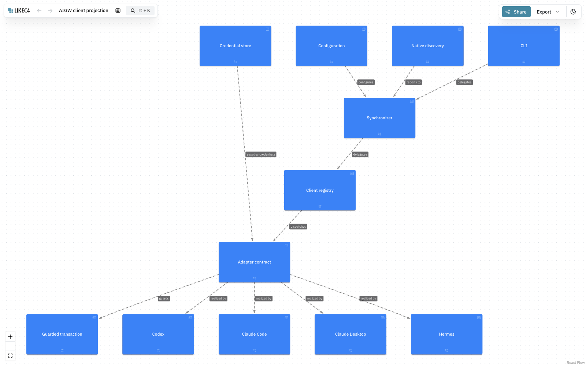
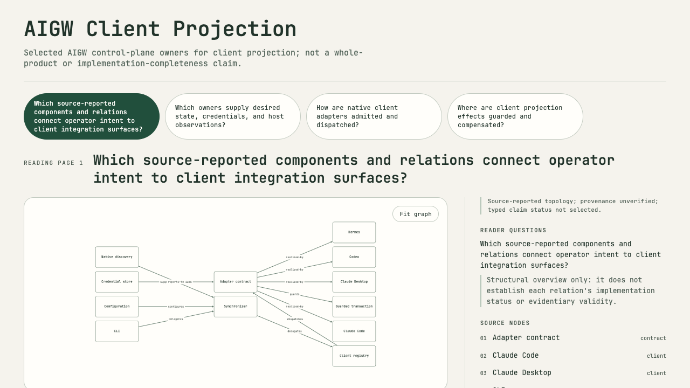
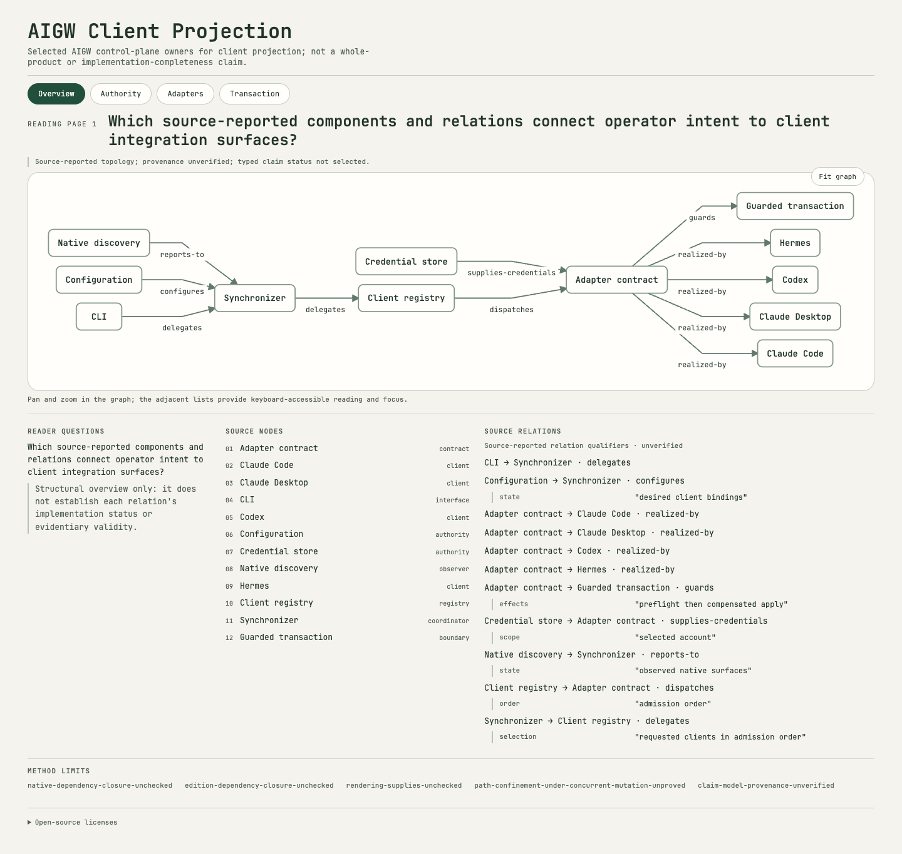

# Mechanism evaluation

Framework sources were observed on 2026-09-19. Repository-wiring tools were
observed on 2026-09-20. Versioned source and executable behavior, not product
claims, are the evidence basis. Line counts are mechanical counts of tracked
code-like files; they measure surface area, not quality or semantic density.

Linked figures are dated experiment evidence, not current accepted
publications. The [product contract](../product-contract.md) owns the current
authority diagram; the [operational reference](../reference/operations.md)
identifies released artifact bytes. Do not replace a historical counterexample
image with a newer Candidate under the same evidence label.

## Decision invariants

The product compiles selected source bytes and explicit product meaning into
recoverable architecture publications. It must not become a second intent
store, repository lifecycle, workflow state machine, code-graph authority,
editor, marketplace or resident service.

The evaluation therefore asks five questions:

1. What concrete implementation exists?
2. Which named consumer in this product needs it?
3. Is the derived state rebuildable from authoritative inputs?
4. Does it preserve source, intent, observation, proof and authorization as
   distinct concepts?
5. Is its total ownership cost lower than the narrower existing mechanism?

## Source baseline

| System                 | Evaluated source                                                             | Tracked code-like lines | Implemented center of gravity                                                             |
| ---------------------- | ---------------------------------------------------------------------------- | ----------------------: | ----------------------------------------------------------------------------------------- |
| COMET                  | `0.4.1`, `9c6a89857f8ce33c12b9abcc1230bd1076de8068`                          |                 464,994 | Native/classic workflow runtimes, checkpoints, trajectory recovery, Skills and evaluation |
| OpenSpec               | `v1.13.1`, `634c557bd0470eec37861b46172c3f503d283c1b`                        |                 129,377 | Change artifacts, schema validation, status and archive/sync lifecycle                    |
| Spec Kit               | `v1.0.8`, `0cc9a6a1159471a3108b9bad718ba17006dd6039`                         |                 184,138 | Constitution, templates and agent-oriented specification workflow                         |
| SpecD                  | `0c1053f635b7a206aaa7c66ff86720aa2224c1b7`; core `0.2.0`, code graph `0.3.0` |                 217,160 | Context compilation, lifecycle and SQLite-backed multi-language code/spec graph           |
| ETHOS                  | `75d997cadcb306077f77ad710080363a9f65c69f`                                   |                 117,362 | Repository authority, owned lanes, proof, controlled effects and attestation              |
| Architecture Publisher | `2009af0e0398403d610873e2286823873b4c8097` baseline                          |                  81,041 | Source-bound semantics, composition, rendering, observation and recoverable publication   |

The table is an evaluated baseline, not a latest-release claim. A read-only
GitHub check on 2026-09-29 found newer stable releases of
[COMET `0.4.3`](https://github.com/rpamis/comet/releases/tag/0.4.3),
[OpenSpec `v1.13.2`](https://github.com/Fission-AI/OpenSpec/releases/tag/v1.13.2),
and [Spec Kit `v1.0.12`](https://github.com/github/spec-kit/releases/tag/v1.0.12).
SpecD still had no GitHub Release; its observed default-branch commit was
[`ddd990c`](https://github.com/specd-sdd/SpecD/commit/ddd990c7054bc25b95f2d4659a2d78866fc6d8a0).
The newer releases and commit have not received the source-level comparison
below. Release notes are leads for reevaluation, not proof of implementation.

Primary source locations:

- <https://github.com/rpamis/comet/tree/0.4.1>
- <https://github.com/Fission-AI/OpenSpec/tree/v1.13.1>
- <https://github.com/github/spec-kit/tree/v1.0.8>
- <https://github.com/specd-sdd/SpecD/tree/0c1053f635b7a206aaa7c66ff86720aa2224c1b7>
- <https://github.com/salsa-rs/salsa>
- <https://codeql.github.com/docs/codeql-language-guides/analyzing-data-flow-in-javascript-and-typescript/>
- <https://www.w3.org/TR/shacl/>
- <https://egraphs-good.github.io/>
- <https://constraints.cs.washington.edu/cassowary/>
- <https://slsa.dev/spec/v1.2/provenance>
- <https://in-toto.io/>
- <https://github.com/sverweij/dependency-cruiser/tree/v18.4.0>
- <https://github.com/webpro-nl/knip/tree/knip%406.37.0>
- <https://github.com/publint/publint/tree/v0.3.24>
- <https://github.com/javierbrea/eslint-plugin-boundaries/tree/v7.2.0>

## Adopt, reject and defer

| Domain                       | Observed mechanism                                                                                                                                                                      | Decision                                                                   | Concrete consumer and boundary                                                                                                                                                                                                                                                                                                                                                                                                                                                                                                                                                                                                                                                                                                      |
| ---------------------------- | --------------------------------------------------------------------------------------------------------------------------------------------------------------------------------------- | -------------------------------------------------------------------------- | ----------------------------------------------------------------------------------------------------------------------------------------------------------------------------------------------------------------------------------------------------------------------------------------------------------------------------------------------------------------------------------------------------------------------------------------------------------------------------------------------------------------------------------------------------------------------------------------------------------------------------------------------------------------------------------------------------------------------------------- |
| Intent and specification     | OpenSpec 1.13.1 prevents normalized duplicate requirements, validates malformed task markers and hardens archive/sync ordering. Spec Kit supplies constitution and template discipline. | **Adopt current carrier; borrow editorial discipline.**                    | OpenSpec remains the repository's explicit change-intent carrier. Constitution-style invariants may improve authored guidance, but Spec Kit's workflow must not become another lifecycle owner.                                                                                                                                                                                                                                                                                                                                                                                                                                                                                                                                     |
| Code semantics               | SpecD implements multi-language symbols, dependency/impact queries, stale latches and a SQLite graph store. CodeQL separates syntax, control flow, data flow and taint semantics.       | **Adopt typed relation and freshness boundaries; reject graph authority.** | Source-bound architecture inputs must name relation kind, evidence revision, analysis boundary, freshness and loss. A graph may be rebuilt as observation; it cannot replace accepted product intent. Do not add SQLite until a real consumer needs persisted queries.                                                                                                                                                                                                                                                                                                                                                                                                                                                              |
| Incremental computation      | Salsa tracks query inputs and invalidates dependent derived results by revision and durability.                                                                                         | **Defer.**                                                                 | Two adopters do not yet show that selective recomputation would repay a new runtime and cache-coherency contract. Current complete bounded compilation remains simpler and auditable.                                                                                                                                                                                                                                                                                                                                                                                                                                                                                                                                               |
| Semantic validation          | SHACL validates typed graph shapes independently of a particular storage engine.                                                                                                        | **Defer.**                                                                 | The current finite JSON semantic vocabulary already fails closed. Reconsider shape languages only when third-party extensions require an open vocabulary that cannot remain a closed schema.                                                                                                                                                                                                                                                                                                                                                                                                                                                                                                                                        |
| Equivalence                  | E-graphs compactly represent explicit rewrite equivalences and support equality saturation.                                                                                             | **Reject for inferred intent; defer for exact transformations.**           | They may later optimize declared diagram rewrites. They must never infer that two natural-language intents or product commitments are equivalent.                                                                                                                                                                                                                                                                                                                                                                                                                                                                                                                                                                                   |
| Constraint layout            | Cassowary separates required constraints from weighted preferences and updates layouts incrementally.                                                                                   | **Defer.**                                                                 | The current finite compositor has deterministic explicit groups, order, ports and routes. Introduce a solver only after a third real adopter demonstrates an otherwise irreducible layout family and a bounded unsatisfiable-core contract.                                                                                                                                                                                                                                                                                                                                                                                                                                                                                         |
| Assurance                    | SLSA provenance separates subject, builder and resolved dependencies; in-toto records signed step materials and products.                                                               | **Adopt field boundaries, not the full frameworks.**                       | Publication evidence should keep artifact subject, builder/verifier identity, selected dependencies, observations and byproducts distinct. Existing exact digests and attestations remain the product contract.                                                                                                                                                                                                                                                                                                                                                                                                                                                                                                                     |
| Verification                 | Independent verification is often treated as a separate service.                                                                                                                        | **Adopt a smaller rule.**                                                  | A verifier is a pure, predicate-specific executor over exact immutable inputs. Use a distinct trust domain only where risk or policy requires it; do not create a resident verifier service or duplicate the workflow state.                                                                                                                                                                                                                                                                                                                                                                                                                                                                                                        |
| Recovery                     | COMET checkpoints and in-toto/SLSA provenance improve resumability and traceability; this product already journals prestates and exact plans.                                           | **Keep current owner; borrow explicit pending/outcome vocabulary.**        | File publication retains exact plan binding, prestates, journaled effects and rollback. A status projection may distinguish pending action from observed outcome without becoming a new ledger.                                                                                                                                                                                                                                                                                                                                                                                                                                                                                                                                     |
| JavaScript dependency policy | dependency-cruiser `18.4.0` implements cycle, unresolved, orphan, required-dependency and transitive-reachability rules over the module graph.                                          | **Defer replacement; use as an independent audit.**                        | A scoped run over `src`, `adapters`, `renderers`, `editions`, `conformance/journeys/self-host`, and `tools`, without recursively expanding external packages, observed 88 modules and 318 dependencies: 73 first-party modules, 3 vendored modules, 11 Node built-ins, and one external development dependency, with no unresolved dependency, cycle, orphan module, or rule violation. Keep the smaller Acorn gate because it additionally enforces the repository's semantic owner policy and fails computed imports, package escapes, undeclared externals, and module-relative resource URLs. Replace extraction only when a reproducible missed edge exists and the mature engine can preserve every stricter local invariant. |
| Dead files and exports       | Knip `6.37.0` implements entry-aware unused file, export and dependency analysis.                                                                                                       | **Adopt as an implementation gate; never auto-fix.**                       | An unconfigured run treated intentional executables, qualification tools and bundled renderer supply as unused. After declaring the real CLI, self-host, migration, browser and installed-evolution entries, the default graph closes development/test seams and the strict production graph excludes development-only dependency admission. Local-only exports were narrowed manually. Knip remains an implementation-observation tool; it does not define semantic owners or delete code.                                                                                                                                                                                                                                         |
| Package surface              | publint `0.3.24` validates npm package metadata and packed layout.                                                                                                                      | **Adopt as an independent package predicate inside the repository gate.**  | `npm run check:package` validates the actual packed core after behavior and static checks. Installed public journeys still own offline execution and supply-drift rejection; publint neither replaces those journeys nor grants release acceptance.                                                                                                                                                                                                                                                                                                                                                                                                                                                                                 |
| Boundary linting             | ESLint `10.11.0` supplies broad zero-warning JavaScript correctness rules; eslint-plugin-boundaries `7.2.0` can classify dependencies by element, file category, and origin.            | **Adopt ESLint; retain the smaller semantic boundary checker.**            | ESLint now owns general first-party linting. The repository's Acorn-based gate separately derives package exports from their manifests and enforces semantic owner direction, computed-import rejection, package escape rules, declared externals, and executable composition roots. Do not add a second boundary authority unless a reproduced missed edge cannot be expressed by the existing checker.                                                                                                                                                                                                                                                                                                                            |
| Security and data flow       | CodeQL models syntax, control/data flow and taint across supported languages.                                                                                                           | **Use only for security-specific questions.**                              | It complements but does not replace ownership, packaging, installed/offline, recovery or publication-path verification.                                                                                                                                                                                                                                                                                                                                                                                                                                                                                                                                                                                                             |

## Measured terminal decisions

Three independently installed runs per consumer measured the current exact
`architecture-publisher` package. Median complete build versus affected-view
analysis was `4918.980 ms / 27.361 ms` for self, `5517.154 ms / 87.610 ms`
for ETHOS, and `2036.866 ms / 9.788 ms` for source-owned AIGW. Outputs were
deterministic in every run. Analysis therefore consumed at most `1.588%` of a
complete build, while each real measured change still selected the static view
and multiple interactive views for rebuild.

The terminal decision is to defer persistent graph storage, incremental query
runtime, and a general constraint solver. The present bottleneck is required
media work, not semantic dependency traversal. No consumer exhibited a
persistence failure, irreducible query, or unsatisfiable finite composition.
Reopen a decision only with a named failing consumer case and a benchmark that
demonstrates lower total ownership cost. The fixed 0.2/alpha.1 observations and
report digests are retained in
`conformance/evidence/first-party-contract-matrix.json`; they are historical
evidence, not current cross-product acceptance.

## Mechanism-wiring audit rule

A mechanism is connected only when all five links are present:

```text
declaration -> implementation owner -> composition or public entry
            -> real consumer -> predicate-specific verifier/evidence
```

A static import graph proves only one part. Repository acceptance also checks
module direction, declared executable entry points, package closure, relocated
offline use, failure and recovery paths, and whether evidence exits through its
existing owner. Derived graphs remain disposable observations. They do not become
a registry, cache authority, lifecycle state, or second task ledger.

The current default and production graphs found no unreachable first-party
JavaScript module from the declared CLI, self-host, migration, browser, and
installed-evolution entry points. The audit narrowed 25 public-looking exports
that had only module-local use or no consumer. The remaining development and
test seams are marked `@internal`; Knip validates them in the default graph and
intentionally excludes them from production export claims. The previously omitted
installed-evolution executable now belongs to the repository syntax gate. The
repository-owned regression rejects imprecise first-party owner paths, unadmitted
dynamic imports, and any authored JavaScript module omitted from that gate.

### Mechanism-subtraction audit (2026-09-26)

This is a dated decision audit, not a second progress ledger. A step is redundant
only when it establishes the same fact from the same selected bytes for the same
consumer under the same authority. Line counts identify review pressure, not
defects. The Publisher Work Lane was at signed `77ac268` with an uncommitted
grouping draft; ETHOS was at `0e2494859`, and AIGW at `04f593a4`.

- **Structural grouping — redirect.** The two-node LikeC4 static smoke test is
  not AIGW acceptance. The current AIGW Client Projection asks four questions
  and authors five groups over 12 entities, 11 relations and 11 claims. A
  source-adjacent trial positioned its 5/12/11 structural subset with the same
  neutral geometry owner, but rendered and qualified neither medium. Admit the
  successor only after that editorial scope and distinct relation/claim
  carriers work; do not add a second layout engine without a geometry-specific
  failure.
- **AIGW source preparation — replace after parity.** Its v1 materializer is
  621 lines, 14 tracked `_source/source/**` files mirror repository bytes, and
  `provider.json` repeats two exact hashes. The v2 selected-input contract can
  remove mutable copies and duplicate fields only after AIGW accepts an
  installed replacement with the same source and editorial meaning. Preserve
  historical inputs.
- **ETHOS integration — separate owners.** The current adapter package has
  10,479 first-party `.mjs` lines including tests. It hosts generic browser,
  render, qualification and publication work; its Provider writes a temporary
  Source Bundle for a digest before returning the same members. Retain
  ETHOS-specific semantics, Edition authorship and flagship art direction;
  remove the roundtrip and displaced generic pipeline only after exact media,
  governance and rollback parity.
- **Publisher self-use and predecessors — retire after parity.** The self
  Edition has 4,250 first-party runtime lines, and historical v1 paths coexist
  with the unreleased successor. Source tests and Knip find no unreachable
  first-party module today; that does not justify indefinite duplicate public
  paths. Migrate self-use through the same installed API as unrelated adopters,
  then remove displaced mutable owners and exports with a SemVer migration.
  Keep signed historical refs and frozen release fixtures.
- **Repeated preparation — measure first.** Edition authoring is validated in
  materialization and parsed again in the meaning and native-selection phases;
  LikeC4 semantics and layout can parse the same selected bytes separately.
  Share an immutable result only within one trust boundary and parser identity
  if measured savings exceed coupling. Do not add an ambient cache or weaken
  a public entry's validation.
- **Distinct claims — keep.** Byte identity, semantic equivalence, Candidate
  integrity, predicate observations, accepter policy and recoverable file
  publication establish different facts. Static and interactive media have
  independent geometry and accessibility. Executable Provider containment is
  a separate trust boundary. Similar hashes, checks, media and workers are not
  redundant when claims or adversaries differ.
- **Workflow — shorten the loop, not the bar.** The active `tasks.md` exceeds
  600 lines and repeats test history. On signed `779915c`, 1,023 behavior tests
  passed with five skips, but branch coverage was 92.93% against the 95% gate.
  Keep `tasks.md` as the sole current-state ledger, condense historical
  narration at coherent closeout, use focused RED/GREEN and static/package
  checks per slice, and run the full coverage gate at bounded milestones and
  final freeze. Do not waive it for release.

The next subtraction decision is therefore consumer-first: prove the full AIGW
question and media path before deleting v1 owners or adding another engine.
Progress that only moves a model through more intermediate formats is not a
product outcome.

#### Full-chain redundancy triage

An apparent duplicate is removable only after naming the author, fact,
consumer, trust boundary and replacement proof. An author-edited copy of the
same fact is different from an independent predicate over immutable bytes.
This table records source-level findings on signed Publisher `c842120`, ETHOS
`0e2494859` and AIGW `04f593a4`; it does not claim that the proposed
replacement has passed installation or reader acceptance.

| Boundary                         | Observed cost or gap                                                                                                                                                                                                               | Disposition and proof before subtraction                                                                                                                                                                                                                                                                       |
| -------------------------------- | ---------------------------------------------------------------------------------------------------------------------------------------------------------------------------------------------------------------------------------- | -------------------------------------------------------------------------------------------------------------------------------------------------------------------------------------------------------------------------------------------------------------------------------------------------------------- |
| Edition authoring                | One selected source reference also needs a separately edited `requiredAssertions` record; `narrative.readingOrder` is copied into the interactive Scene hash although navigation follows ordered views.                            | Derive the source assertion from the selection and derive ordering from medium views and their questions. Keep one immutable projection and test two-question, omission and historical-v1 behavior. `narrative.readingOrder` is not wholly unconsumed: its current hash effect must be replaced deliberately.  |
| Context dependency               | A questionless selection used as editorial basis can be retargeted without affected medium or human review; `covered-elsewhere` can name a source assertion that does not exist.                                                   | Treat context-only as free from its own visible-coverage obligation, not from source binding or dependency propagation. Reject invented coverage transfers and prove the exact counterexamples before declaring authoring simplification safe.                                                                 |
| Editorial attribution            | Static SVG emits an editorial statement without its proponent or unverified status; interactive HTML shows both.                                                                                                                   | Bind the same attribution semantics to each public medium and test emitted bytes, not only Scene fields. Independent medium layouts remain necessary.                                                                                                                                                          |
| Capability surface               | The earlier Edition Project accepted `query` selections and `transformations`, but native selectors and meaning compilation rejected them. `presentation.intent` is author-required yet only evolution, not composition, reads it. | Remove query and transformation fields from the unreleased Project; only a versioned, exercised consumer can restore them. Review `presentation.intent` separately as editorial intent rather than silently treating it as a working layout control. Do not retain empty syntax through a compatibility layer. |
| Cross-product source preparation | AIGW tracks 14 `_source/source` copies and a 621-line materializer; ETHOS writes a temporary Source Bundle to obtain a digest, then returns the same members.                                                                      | Replace at the source-owned Provider boundary after exact installed input, semantic, media, rollback and source-author acceptance parity. Historical signed bytes remain immutable; no Publisher import of adopter-specific semantics.                                                                         |
| Generic execution placement      | ETHOS integration still owns generic rendering, browser, qualification and publication paths while Publisher develops those same responsibilities. Self-use also retains predecessor paths.                                        | Route each function to its one product owner, then delete displaced mutable code and exports after installed public-path parity. Keep ETHOS governance and art direction, AIGW source facts, and historical replay at their original owners.                                                                   |
| Repeated parsing or validation   | Edition authoring is read and validated at several public/trust boundaries; LikeC4 import and layout may parse the same selected bytes separately.                                                                                 | Measure same-boundary duplicate work before sharing an immutable result. Keep independent public-entry and selected-byte validation; a process-wide cache or weaker trust check would save apparent steps while losing assurance.                                                                              |
| Qualification and effects        | Source identity, semantic coverage, medium observations, human judgment, Candidate binding and recoverable publication all inspect overlapping data.                                                                               | **Retain.** They answer different predicates for different authorities. Reuse an exact observation only when subject, predicate, verifier version and trust boundary match; never merge approval with transport or rendering.                                                                                  |
| Process containment              | Provider, parser, renderer and replay use child processes with different local limits; nested groups can outlive an outer-only kill.                                                                                               | Use one owned supervision design and an invocation-wide deadline before claiming bounded replay. Do not replace it with `Promise.race` or remove a worker merely to reduce files; fail closed where descendant cleanup is unproved.                                                                            |
| Workflow evidence                | The active `tasks.md` is 630 lines and repeats per-slice test histories; a full coverage run remains below the 95% branch floor.                                                                                                   | Keep tasks as the sole progress ledger, condense stale narrative at closeout, and run focused RED/GREEN plus static/package checks per slice. Full four-dimensional coverage and exact release tests remain mandatory at freeze. No second dashboard or waiver.                                                |

The order is subtraction before addition: remove duplicate author input, prove
the mixed AIGW reader path, migrate adopters, retire displaced owners, then
consider new engines only for a reproducible remaining gap. A source-level
`query`/`transformation` rejection is not a successful implementation of those
features, and an installed source lock is not a qualified publication.

A read-only authoring probe against AIGW `04f593a4` retained its four reader
questions, five static groups, twelve entities, eleven relations and eleven
claims. The inspected Work Lane's Project validator accepted 22 selected
references whose question links derive 22 source assertions; no second
source-assertion record was authored. This establishes an input-cost reduction
only. Relation and claim IDs were selected separately, while each question's
current claim list supplied the links and the current static group membership
supplied the five group declarations. The probe omitted source-specific route directives and produced no
Candidate or public media; its line count cannot be compared as a
meaning-preserving replacement for AIGW's current Edition.

The same AIGW source has eleven claims, each with one explicit `dependsOn`
relation at the same source revision; all eleven also match that relation's
subject, predicate and object. Seven `claimCard` fact labels have identical
values across all eleven claims: plane, condition, maturity, validity,
coverage, selected claimant and model owner. Subject, predicate, object,
scope and evidence authority vary or serve as per-claim anchors. A read-only
claim-only SVG probe with exact cards rendered an 11-carrier, 1214 × 2637
canvas, factoring the common plane and condition once. This is neither the
five-group structural scene nor a qualified AIGW publication; it only bounds
the cost of a nonduplicating static grammar.

With the same AIGW source, a separate read-only, source-adjacent trial of the
unreleased Edition Project carried all four questions, five authored groups,
eleven relation selections and eleven claim selections through materialization,
meaning and shared grouped geometry. A later temporary trial on AIGW source
HEAD `04f593a4` and Claim Model SHA-256
`1975b7af02b3e28268feb9b4ed7fab88caac6e7bb44df484a6f133275775dabd`
built a paired, unqualified Candidate with twelve static nodes, eleven
relations, eleven distinct claim cards and 22 independently bound source
assertions. Its eleven relation/claim links derive from same-source typed
dependencies, not another edited input. Exact Candidate replay matched.
Background Chrome showed four complete pages with 11, 3, 6 and 2 linked
claims, no console errors or horizontal overflow at 1280 CSS pixels,
and no axe WCAG 2/2.1 A/AA violations. This was a source-adjacent authoring
trial, not an installed or source-owned AIGW Provider migration. A subsequent
exact-field factoring pass expressed seven page-common claim facts once;
at 1280 CSS pixels the first interactive page shortened from 4,463 to 3,627
pixels. All four pages again showed 11/3/6/2 claim carriers with no console
errors, no horizontal overflow and no axe WCAG 2/2.1 A/AA violations.
The static work remains text-dense, interactive graph labels are small and
per-claim anchors remain long; no final reader-quality, source-owner or human
acceptance was granted. All owned temporary Candidates, browser sessions and
servers were removed.

## Revisit triggers

Reconsider a deferred mechanism only when a named adopter supplies a failing
case, measurable current cost and acceptance test. In particular:

- add incremental invalidation only after repeated complete builds dominate a
  real workflow;
- add an open shape system only after the closed vocabulary blocks a required
  extension;
- add a constraint solver only after explicit finite composition cannot express
  a required layout;
- persist a code graph only after rebuildable observations prove insufficient;
- add stronger independent execution only where the relevant policy requires a
  separate trust domain.

This preserves a small semantic kernel while leaving deliberate extension seams.

## AIGW direct-framework visual counterexample (2026-09-24)

A direct LikeC4 probe used AIGW `3318c81978917a0d16d6d16073d313ca78ee2736`'s
selected `architecture/edition-provider/_source/semantic.json` (SHA-256
`fc12aeef70916801b5bb25615b7b9db698471abc29bf4998f22b6482cf7b6672`).
The [frozen probe](../../conformance/fixtures/research/aigw-likec4-direct.c4)
maps its 12 entities and 11 directed relations to one overview. It retains
selected IDs and status fields as LikeC4 metadata but intentionally omits parts
of the source Claim Model. It is a visual baseline, **not** an equivalent
Architecture Edition or an AIGW-owned live input.

Installed LikeC4 `1.59.4` validated the probe and built a standalone
`--output-single-file --use-hash-history` HTML (SHA-256
`ff2fa9d931f3f194d9220db31af6be136664a2f1148a8e183dd0d9b68dc500dd`).
Background Chrome opened that file offline at 1600 by 1000 pixels without a
failed request or page error. The published core/layout API preserved 12
entity IDs and 11 relation IDs in the model. Computed view edges had generated
IDs and no direct metadata field, although LikeC4's
[`EdgeModel.relationships()`](https://github.com/likec4/likec4/blob/33dbc2d34c399a99daf96e92fc28fe5d280a7fd5/packages/core/src/model/view/EdgeModel.ts)
can expose their model relations within one build. An exact
claim-to-_visible_-carrier mapping remains unproved. Native `likec4 export png` failed on this host because
its expected Playwright headless-shell executable was absent; this is a local
installed-use gap, not proof that LikeC4 cannot export PNG elsewhere.



The direct default image (SHA-256
`817e125610e1d17b1326fe3bc981a7e9b2f5f609d26f51203339c8855d6c4cae`)
is a uniform blue-box graph with weak differentiation, substantial empty space,
and no editorial treatment of authority, credential supply, guarded effects,
or client projection. The user rejected this visual result. **Decision:** do
not substitute LikeC4's default renderer for a release-quality AIGW Edition.
LikeC4's versioned model, view, and layout mechanisms remain candidates for
reuse behind a product-owned editorial composition and semantic-carrier check;
their fit requires a styled multi-view AIGW, ETHOS, self, and unrelated-domain
counterexample rather than a favorable two-node smoke test.

## D2 static-renderer counterexample (2026-09-24)

Installed D2 `v0.9.0` was exercised on AIGW `3318c81978917a0d16d6d16073d313ca78ee2736`'s
selected 12-entity, 11-relation Client Projection model (source SHA-256
`fc12aeef70916801b5bb25615b7b9db698471abc29bf4998f22b6482cf7b6672`).
A disposable 26-line D2 script (SHA-256
`b7b525321ec70745abcb2ffad75d86fcacc957e5601881ca46347e3bc1d19cb1`)
used each source entity ID and label as a node and each source relation's
endpoints and type as a directed labeled edge. It intentionally omitted
qualifiers, provenance, plane and Edition decisions: this is a renderer/layout
probe, **not** an equivalent AIGW architecture publication.

`d2 validate` passed. With `--omit-version`, Dagre, ELK and TALA each emitted
SVG containing 12 node groups and 11 path connections. Two consecutive runs
per layout produced identical SVG bytes; their first-run SHA-256 values were
`ff72981ae8615bfa19e33921e8f09bb88316211a513923a6aa0c61edd4c8579b`,
`d5a3c17e65ba34ff36b55a1a816cdd02820a04421747e3f8c9e1fff440765e4c`,
and `049516ec3dc3b7b8a6b527f88e9ed81415ff7a73d8aa96ee09061e048b1f7b9e`.
The TALA no-tooltip PNG also repeated byte-for-byte (174,069 bytes; SHA-256
`831f6ed11fb6d7e47f9f538c8d2863d6e31310b2d8916cf1fde8d037e9ca770a`).
This is scoped repeatability of one fixed input and host, not a general
cross-platform determinism result.

An alternate script put source relation IDs in D2 edge tooltips. The SVG did
not expose those raw IDs as text; the PNG instead gained an 11-item tooltip
appendix, growing TALA output from 174,069 to 319,502 bytes and occupying a
large region outside the graph. Tooltips therefore cannot be used as a hidden
substitute for static semantic coverage or a clean exact-ID carrier. SVG
connection groups encode `(source -> target)[ordinal]` in base64 CSS classes;
a two-edge `a -> b` counterexample showed that swapping source order swaps
which labeled relation occupies ordinal 0. A Publisher adapter would need an
explicit per-build relation-to-carrier map and ambiguity handling, not a claim
that D2's generated ordinal is a stable source relation ID.

The no-tooltip TALA image was manually inspected as a baseline: it retains
basic topology but uses uniform boxes and has crowded relation labels, no
source/maturity framing, and no editorial hierarchy. It is not publication
quality for the whole AIGW product; neither the input nor the probe attempted
that composition. The installed D2 CLI offers static SVG/PNG/PDF/PPTX/GIF/TXT
output, not a standalone interactive HTML atlas. **Decision:** retain D2 and
its qualified layouts as static backend candidates; do not treat direct D2
output as the Edition or let tooltip metadata manufacture visible coverage.

## Archify capability versus Publisher use (2026-09-24 baseline)

At this baseline, the packed, hash-checked Archify supply was version `2.16.0` at
source `c826e6c3a7abad19c0f3cd1ca57207d54b1ad8de`; the manifest at
`packages/publisher/renderers/archify/supply/supply.json` now selects a later
version. The baseline architecture schema and runtime implemented optional guided views, finite trace
motion, cards, a grid layout, source references, repository links, themes, and
visual presets. This is a concrete renderer capability inventory, not a claim
that each feature improves every Edition.

The then-current backend-neutral `architecture.interactive-scene/v1` already fixed
node positions and sizes. Its generic compiler laid groups into rows with
fixed 170-pixel cells, 70-pixel gaps, and 210-pixel group spacing. The Archify
adapter forwarded nodes, regions, and routes, but fixed `locale=en`,
`quality_profile=showcase`, `visual_preset=editorial`, and a hidden legend. It
does not select native views, cards, grid layout, or trace motion. The public
native renderer explicitly rejects `repository` and node `sources` fields in
offline input. These facts are visible in
`packages/publisher/src/scene/interactive/architecture.mjs`,
`packages/publisher/renderers/archify/architecture.mjs`, and
`packages/publisher/renderers/archify/index.mjs`; they identify both
Publisher-owned constraints and unused native facilities, not an Archify
failure.

The native facilities also had real limits. The baseline schema capped guided
views at five and node source references at three, accepted only a GitHub URL and
40-hex revision for its repository link, and offered only `grid` as its
architecture layout mode. Those cannot represent ETHOS's complete 13-page
Atlas, arbitrary multi-source/content-derived revision evidence, or a
flagship composition merely by toggling options. Animation is a finite reader
aid, not an observed runtime trace. Cards or hidden view metadata cannot
manufacture visible source coverage.

**Disposition:** retain Archify as one qualified interactive-renderer
candidate, not a semantic authority or forced universal presentation. A
successor may expose only Editor-selected preset, locale, legend, guided
chapter, card, or motion controls whose exact medium and accessibility tests
pass; it must not pass adopter-specific or unverified provenance directly to
Archify. Compare its native grid and interaction with LikeC4/D2 and the
current Publisher composer on the same reader questions before replacing a
layout owner. Use the richer feature only when it removes actual adopter work
without weakening source binding, independent media, or flagship quality.

## Archify 3.0.1 supplier boundary (2026-09-29)

The selected upstream [v3.0.1 release](https://github.com/tt-a1i/archify/releases/tag/v3.0.1)
is commit `2ab3cae7ac2c2a55d7386ca789d03c4fcd31816c`; its canonical ZIP
SHA-256 is `b0b23bd28db314f04ca8ab9620fe20f8c1ac6474a3546bd8fe4679508aa1b7f5`.
The Publisher supply selects the offline `deliver` CLI closure and notices,
not the Archify Skill or gallery assets. The upstream CLI statically imports
preview and browser-support modules, so those bytes are present even though
Publisher invokes only `deliver` and disables the update check. Archify 3 removes
guided/story views and ordinary share-card exports; its v1 diagram schemas
remain accepted. The former guided-view cap is therefore not a current product
capability claim.

The v3 schema requires portable `meta.output`. A direct native probe rejected
the earlier Publisher input without that field and passed all nine showcase
checks with it. Publisher's adapter now sets that renderer-only field to its
private candidate slot, keeps the original input digest and the caller's
destination separate, and checks the native specification digest. It disables
Archify's update check in the controlled renderer process. Upstream v3 embeds
licensed WOFF2 font subsets; the redundant Publisher-specific font injection
was removed, while other media still use Publisher's verified font supply.
Changing the renderer changes interactive bytes, so source tests do not
transfer earlier browser or human acceptance to the new Candidate.

## Self-use does not yet prove a generic authoring baseline (2026-09-24)

At Publisher `e389d8955366fa87f134d2c80310196033b82241`, the separate
`@architecture-publisher/self-edition` package has 4,243 tracked `.mjs` lines.
Its `interactive-scene.mjs` and static `composition.mjs` alone have 840 and
740 lines. The self package explicitly prepares its Claim Model and Edition,
composes static and interactive flagship scenes, invokes public Publisher
primitives, and assembles its own Candidate. In contrast, the generic
interactive scene compiler positions grouped entities in fixed rows. The
existing installed self-use tests exercise selected public primitives with
that exact self-specific composer; they do not prove an unrelated
maintainer can obtain the same reader quality without writing comparable
composition code.

This is not a reason to delete the self Edition's authored art direction or
count its lines as poor quality. It is a falsifiable product-adoption gap. A
successor bake-off must run the same self source and reader questions through
the ordinary public Build Request, record time and decisions to first readable
static and standalone interactive baseline, then apply declared flagship
refinements through that same path. Compare visible coverage, quality and
source-delta update cost with ETHOS, full AIGW plus its limited Client
Projection, and native di-effect. If self-use still needs a privileged
composition path while adopters must hand-author geometry, the product's
generic authoring promise is unproved even if every existing self test passes.

### Owned-runtime coverage diagnostic (2026-09-24)

At Publisher `d7c9c02`, an isolated `c8 --all` probe included first-party
`packages/publisher/src/**/*.mjs`, `packages/publisher/renderers/**/*.mjs`, and
`editions/self/src/**/*.mjs`, excluding only third-party supply. A first pass
incorrectly excluded every `index.mjs`; inspection showed that Archify and
resvg `index.mjs` files are substantial first-party renderers, so the figures
below come from re-reporting the same raw test run with those files included.
It ran the unchanged `npm test` (615 pass, 2 skip) with coverage files under
`/tmp`; it did not alter the repository's configured gate. The combined result
was **96.54%** statements/lines, **92.26%** branches, and **98.64%** functions.
Of 4,605 branch units, 4,249 were covered; at that fixed denominator, 126 more
covered units would reach 95%. This is a diagnostic shortfall, not a passing
expanded gate or a prediction after source changes.

The aggregate also masks owner-specific gaps: `editions/self/src/runtime.mjs`
was not exercised, `packages/publisher/src/rendering/atlas.mjs` had 54% line
coverage, and the first-party Archify entry had 75.39% branch coverage. The
successor must first identify retained versus displaced
owners, then make each retained public entry and effectful path testable while
bringing all four aggregate dimensions above 95%. Adding tests solely to
soon-to-be-deleted composition code would increase migration cost without
improving the accepted successor; excluding retained code to manufacture a
passing percentage would be equally invalid.

### Comparable reader-question boundary (2026-09-24)

A tool bake-off needs the same promised reader questions, not merely the same
node count. The current selected source and Edition carriers have different
levels of editorial explicitness:

- **Publisher self (`d26773b`):** `editions/self/src/edition/prepare.mjs`
  authors eight explicit questions from overview through evolution. This is a
  usable editorial baseline, but its composition remains self-specific code.
- **AIGW Client Projection (`ea9b600b`):** Its Edition authors four prompts:
  overview, authority, adapters, and transaction, with eleven required claims.
  It is one chapter; human and recovery qualification are not selected.
- **ETHOS terminal (`709347f0`):** The view profile declares 24 aggregates and
  seven forbidden pairings; the Atlas catalog names thirteen pages. Neither
  selected JSON carrier authors per-page reader questions. Current
  `src/edition/evolution.mjs` generates default Edition prompts from page
  labels. Those prompts are incumbent code-authored defaults, not a separate
  question policy in the selected JSON; their successor use needs editor review.
- **di-effect (`8a168b6b`):** Three native LikeC4 views use `include *`; its
  accepted decision authorizes LikeC4 and Mermaid export. The DSL states no
  reader questions or reader-specific subsets.
- **Full AIGW product:** No whole-product Edition is tracked under
  `architecture/`; the current Provider owns only Client Projection. A complete
  product candidate needs a named editor and source-bound scope decision.

For feasibility probes, Publisher may state researcher-proposed questions where
none are authored, but must label their proponent and cannot treat a good-looking
render as source endorsement. Final adopter acceptance needs each designated
Edition editor's exact scope and question decision. This distinction permits a
fair direct-tool comparison for di-effect without forcing Publisher where the
native tool already suffices, while preventing Client Projection from being
rebranded as complete AIGW architecture.

### Frozen successor-comparison inputs (2026-09-24)

These are comparison inputs, not approval to reuse old media. Git object IDs
identify source content; SHA-256 values identify local bytes. The observed
source checkouts were clean except for di-effect's unrelated
`.serena/project.yml`, which was neither selected nor modified. A new build
and acceptance must bind their own exact inputs.

- **Publisher self.** Publisher HEAD
  `7af397864b52bdd81015b8e13d53100421bab68c`;
  `editions/self` tree `1a7d3a0c95d2fdab1d56d5be454d2e0edca6c1a8`
  and `packages/publisher` tree
  `3cee2dea0bdfe31d897c4e70e8751c2c8cd7ff06`, both unchanged from signed
  `v0.3.0-alpha.3` commit `b01dafa5ab1f34cdb026afde90821c66b09179da`.
  Eight code-authored questions cover overview, semantics, edition,
  composition, qualification, publication/recovery, adoption and evolution.
  The local alpha.3 6000 × 3375 PNG has SHA-256
  `4a81c81c611b035d7b6c75b895734f89cedc94bee72b52f8f7b1f66867b98490`;
  standalone HTML has
  `a03cdcf780a1c13a63a579517c019b389d583801cc4ce754defea0f438661f52`.
  Release-link readback was observed at 09:50 UTC, not continuously proven.
  The flagship implementation is not generic-authoring evidence.
- **ETHOS terminal.** ETHOS HEAD
  `709347f0ce0965e6a338aa5128c60c4d3f4044a8`;
  `integrations/architecture-publisher` tree
  `31677a318f0f9a072caed7c6b7bb318c71d034d1`; selected
  `system/projections/terminal-architecture/semantic-graph.json` SHA-256
  `6725c589f4f68201b2e1ce099ccc9cfc2b9087411ff34c9ad5d40629a73f629c`.
  Its Atlas has thirteen pages and the view profile has 24 aggregates, but
  per-page questions are code-generated defaults, not independently authored
  selections. The preserved 6000 × 3375 PNG is
  `5f4ea104b95112d84635881600d2c75ae3eae65a45b4b61a4fe5936df3ee3cda`;
  HTML is
  `804971adf9be09d3389d7229441200a4116e5d336334e33fd9b328ba66282cfa`.
  `docs/migration/alpha7-baseline.json` binds those copies to an older release
  baseline; it does not promote the current ETHOS revision.
- **AIGW Client Projection.** AIGW HEAD
  `ea9b600b957f53737eb605772825e43de2d01ac5`;
  `architecture/edition-provider` tree
  `e0f94db982c2f1b05862abcad0147c2b37d2b57f`.
  `provider.json` SHA-256 is
  `47bcec1a8db6bb06ffc7a8148df9f4a6eb3ff097a537112d9373b9553a39350b`;
  `edition.json` is
  `d7ee26e15e603285046f74577296d85fe8a211df601f3f96a86b7cedda2020de`.
  Four authored questions cover overview, authority, adapters and
  transaction, with eleven required claims. Human/recovery qualification is
  not selected. The Provider's content revision is not a Git commit.
  Conformance fixture media identities are Candidate evidence, not AIGW
  acceptance; no accepted media bytes were established here.
- **Whole AIGW product.** The same source revision has no whole-product
  Edition under `architecture/`. AIGW or a named editor must author its scope,
  questions, omissions and art direction; researcher questions remain
  provisional. The Client Projection cannot be relabelled as the whole product.
  No whole-product accepted static or interactive medium is established.
- **Native di-effect.** di-effect HEAD
  `8a168b6b9c6933c30ab2ea25e60cac8a54212566`;
  `tools/likec4/models` tree
  `9d08a56139d2756f46763d426c8febb828a994d7`. The three individual
  SHA-256 values appear in the native LikeC4 counterexample below. Its
  `five_layers`, `packages` and `runtime_flow` views each use `include *`;
  no reader-specific questions are authored. The LikeC4/Mermaid decision and
  a research PNG probe do not establish an accepted Publisher-style
  dual-medium publication.

A direct-tool win for one workload does not imply replacement of another.
Where accepted media or authored questions are absent, that absence limits
parity claims; it does not license invented acceptance or source endorsement.

## Structurizr native-model and export boundary (2026-09-24)

GitHub API readback identified the active Apache-2.0
[Structurizr monorepo at stable `v2026.09.19`](https://github.com/structurizr/structurizr/tree/v2026.09.19)
(`f828a297dc693e08115b7e5b51dba4a83d8148c2`, Java 21). The older
`structurizr/cli` repository is archived; evaluating only that old CLI would
misidentify the maintained product. This is a source-level audit, not an
installed-run or reader-quality result.

The active source contains concrete DSL parser, model/view, custom and dynamic
view, export, autolayout, and application modules. The DSL parser
[stores declared element and optional relationship identifiers as model-item
properties](https://github.com/structurizr/structurizr/blob/f828a297dc693e08115b7e5b51dba4a83d8148c2/structurizr-dsl/src/main/java/com/structurizr/dsl/StructurizrDslParser.java#L1609-L1619).
That is a useful trace carrier, but it does not by itself prove stable
cross-revision identity or exact source-file/line provenance for every exported
relation. A Publisher adapter would still need typed qualifier and loss checks.

The inspected
[static-site exporter](https://github.com/structurizr/structurizr/blob/f828a297dc693e08115b7e5b51dba4a83d8148c2/structurizr-application/src/main/java/com/structurizr/command/StaticSiteExporter.java#L24-L65)
writes an `index.html` plus separate JavaScript, CSS, image, and `workspace.js`
files; it explicitly removes workspace and element documentation because that
static site does not support it. This route is therefore neither a proven
single-file HTML Atlas nor a complete documentation publication. The inspected
[`export png|svg` command](https://github.com/structurizr/structurizr/blob/f828a297dc693e08115b7e5b51dba4a83d8148c2/structurizr-application/src/main/java/com/structurizr/command/ExportCommand.java#L123-L175)
constructs that static site and calls the
[Playwright-backed viewer exporter](https://github.com/structurizr/structurizr/blob/f828a297dc693e08115b7e5b51dba4a83d8148c2/structurizr-application/src/main/java/com/structurizr/command/PlaywrightExporterImpl.java#L26-L74).
That path derives static images from the browser viewer and cannot directly
satisfy Publisher's independently composed static-medium invariant.

**Disposition:** Structurizr is a serious candidate for native C4 source
ingestion, model/view computation, and authoring conventions where the subject
fits C4. Its direct export is not currently established as Publisher's
standalone dual-medium publication backend. Defer any adoption decision until
the exact released toolchain is run offline on self, ETHOS, full AIGW plus its
Client Projection, and native di-effect with visible semantic carriers,
documentation, output identity, accessibility, and maintenance cost measured.
Do not make either its C4 vocabulary or browser-derived image route a universal
architecture ontology or a substitute for the Edition editor.

## Native LikeC4 identity and editing counterexample (2026-09-24)

At di-effect `8a168b6b9c6933c30ab2ea25e60cac8a54212566`, three authored
files in `tools/likec4/models/` total 102 lines. Their SHA-256 values are
`45d81011acbf12ad35ce2daef4b27773d66b9fa73f3aac084f252c29aa9bfbcd`
(`di_effect_core_layers.c4`),
`683df86d00ed3467a21942c00f79f2252871b8159a5957e1c196fd90eb3886a3`
(`di_effect_packages.c4`), and
`b601586c58810816b5489a95be0e4e5830c6e6b5237bc179d1c88a0ef194ef5e`
(`di_effect_runtime_path.c4`). The unrelated dirty `.serena/project.yml` was
not changed or used.

Read-only source copies in isolated `/tmp` directories were processed with
installed LikeC4 `1.59.4`: `likec4 validate --json <copy>` passed for all three
files, and `likec4 export json --skip-layout -o <copy>/model.json <copy>`
produced 25 elements, 35 relations, and four views. The generated index and
all three authored `include *` views each contained 25 nodes and 35 edges;
each view edge referenced valid model relation IDs. This demonstrates usable
native ingestion and within-build relation trace, **not** reader-specific
composition or actual visible semantic fidelity. The inspected export carried
no per-relation `sourcePath` field. That limits JSON-only consumption, not
LikeC4's public language-service source locations.

A follow-up on 2026-09-24 used the same exact three files with LikeC4 1.59.4's
public [`fromSources`](https://github.com/likec4/likec4/blob/33dbc2d34c399a99daf96e92fc28fe5d280a7fd5/packages/language-services/src/node/index.ts)
API. It parsed selected in-memory strings with its language service's
`useFileSystem` option set to false; `documentPaths()` returned exactly the
three selected virtual files. This is document-set evidence, not observation
of every possible ambient read. The public
[`languageServices.locate`](https://github.com/likec4/likec4/blob/33dbc2d34c399a99daf96e92fc28fe5d280a7fd5/packages/language-server/src/LikeC4LanguageServices.ts)
returned a file URI and LSP range for a native element, relation, and view.
The relation range was a point location, not a full source span. The model
again contained 25 elements, 35 relations, and four views. These locations
must be translated to selected logical paths and byte digests; virtual or
temporary absolute paths are not durable source identities.

An unlocated view is not necessarily generated. Upstream
[`locateView`](https://github.com/likec4/likec4/blob/33dbc2d34c399a99daf96e92fc28fe5d280a7fd5/packages/language-server/src/model/model-locator.ts)
returns `null` when it cannot find the AST view; the typed
[`sourcePath`](https://github.com/likec4/likec4/blob/33dbc2d34c399a99daf96e92fc28fe5d280a7fd5/packages/core/src/types/view-common.ts)
contract identifies auto-generated views by an absent source path. Therefore a
missing locator for an authored view is an import failure, not permission to
omit that view. Source line bounds can be indexed once per selected file rather
than rescanned for every imported item.

A cold standalone install of `@likec4/language-services@1.59.4` failed at
module import because `@likec4/config`'s Node entry imports
`bundle-require`, which its [package](https://github.com/likec4/likec4/blob/33dbc2d34c399a99daf96e92fc28fe5d280a7fd5/packages/config/package.json)
declares as an optional peer. Installing that declared peer and `esbuild`
explicitly made the in-memory probe pass; the temporary dependency tree was
about 91 MB. The working Homebrew `likec4` installation occupied about
130 MB. This is a measured supply/DX cost, not grounds to handwrite a DSL
parser. A qualified LikeC4 adapter can be optional to generic Publisher
installation; no parser dependency is yet admitted into the release.

### Single-file parser-supply probe (2026-09-25)

On macOS Node `v26.9.0`, esbuild `0.28.2` bundled the installed
`@likec4/language-services@1.59.4` Node entry from 1,365 input modules into
one 5,182,490-byte ESM file. Two same-host builds with the same inputs had
SHA-256 `c0231e4b559dc8d12d4b1bc80b4c5f86643d59a5b1ee9bdc877f60a8e40bf516`.
The naive ESM bundle failed at import because bundled esbuild code used a
dynamic `require('fs')`; a scoped `createRequire(import.meta.url)` banner made
the exercised parser path run. The metafile still declared one non-Node
external, `pnpapi`, from esbuild's optional Yarn-zip branch. A passing parser
path does not establish that every reachable bundle path is ambient-free.

A second banner allowed dynamic `require` only for Node built-ins; a test-only
export rejected `pnpapi` while permitting `fs`, and a two-element parser case
still passed. Without that test-only export, the guarded bundle was 5,182,823
bytes with SHA-256
`e43c4e484d30e259faebb6c1c579fdc19d3b4f7e1ac7660f555aa35a3c2e18a2`;
two same-host builds matched. This constrains dynamic package resolution in
the bundle, not access to ambient files through permitted Node built-ins.

The corrected bundle was copied into a disposable directory with no
`node_modules`, empty `PATH` and `NODE_PATH`, and a fresh `HOME`; the directory
was removed after the probe. Fed the three unchanged di-effect file bytes and
the explicit no-filesystem options, it matched the direct upstream
`fromSources` summary: three selected virtual documents, 25 elements, 35
relations, and four views (three authored, one generated), with no parser
errors. This is a same-host selected-path parity and relocation result, not
cross-platform package acceptance, complete dependency observation, bounded
execution, a license inventory, or visible semantic coverage.

The guarded bundle also parsed the same hash-checked three-file input inside
local Linux ARM64 image
`sha256:cb328da7d1c342b3f542dc65fbd377cf5a4823d5df01f47ea3bd888f57618b4b`
(Node `26.9.0`) with no network, a read-only root and input mount, dropped
capabilities, 512 MB memory limit, and empty `PATH`/`NODE_PATH`. Its three
virtual documents, 25 elements, 35 relations, and three authored plus one
generated view matched the upstream summary. An initial container invocation
failed before Node started because empty `PATH` hid the image's relative
entrypoint; selecting `/usr/local/bin/node` as the absolute entrypoint fixed
that harness error. Both owned probe directories and containers were removed.
This is a selected-path Linux observation, not native Windows conformance,
complete parser behavior, package/license qualification, or a filesystem
sandbox claim.

The esbuild metafile spans 65 installed package roots: 53 declare MIT, six
Apache-2.0, two ISC, two BlueOak-1.0.0, one BSD-3-Clause, and one declares no
license field. The undeclared package is `khroma@2.1.0`; its shipped `license`
file is MIT text (SHA-256
`66b333b0f66759a0b710459e03f7029abe17f4358114a128d2c972e642961b49`).
`remeda@2.50.0` declares MIT but its npm payload has no license file. Through
the read-only GitHub CLI route on 2026-09-25, the exact upstream
[`v2.50.0` commit](https://github.com/remeda/remeda/tree/b9ec4b0ac5ba86f2f687bae6e92d318db02eea24)
provided [LICENSE](https://github.com/remeda/remeda/blob/b9ec4b0ac5ba86f2f687bae6e92d318db02eea24/LICENSE)
with SHA-256 `acf30083045d768ce20640237313ee31a45d548d66ef76df5bb5fb0745479535`.
These observations identify notice sources; they are not a generated license
inventory, legal clearance, or proof that the packed Publisher includes the
required texts. A bundle cannot be admitted until its exact input packages
and complete notices are reproducibly bound to the shipped bytes.

The single-file route is a serious alternative to the previously observed
roughly 91 MB cold dependency tree, not an admitted release supply. Compare it
with an optional installed peer on exact input, install/repair cost, complete
license notices, non-Node external rejection, offline relocation, Linux and
Windows behavior, and bounded execution. Do not add a second package or
command plane merely to avoid this comparison; do not ship a bundle based on
the two-node smoke test or one successful di-effect parse alone.

### Native parser confinement probe (2026-09-25)

Read-only GitHub CLI retrieval of the official Node
[v22.13.0 Permission Model contract](https://github.com/nodejs/node/blob/v22.13.0/doc/api/permissions.md)
and [v26.9.0 contract](https://github.com/nodejs/node/blob/v26.9.0/doc/api/permissions.md)
found the API stable at v22.13.0. Both versions restrict `node:fs` reads,
child processes, and worker threads unless granted; the v22.13.0 contract does
not list network confinement, while the v26.9.0 contract does. Neither is an
OS sandbox: existing descriptors bypass filesystem checks, worker permissions
are not inherited, granted symlinks can escape, and v26 documents a
same-user cross-process inspector limitation. These are upstream statements,
not observations of Publisher's installed product.

A disposable macOS Node `v26.9.0` child ran the exact checked-in LikeC4
bundle (SHA-256
`44d22b467b523e894b8e97f56b33c7f2051fd68077c2edc56cef3497d4c6258f`)
with `--permission`, one exact `--allow-fs-read` bundle-file grant, an inline
module, empty `HOME`/`PATH`/`NODE_OPTIONS`, and no child, worker, write, or
network grants. The selected no-filesystem two-element/one-relation parse
succeeded; separate attempts to read `/etc/passwd` and spawn Node failed with
`ERR_ACCESS_DENIED`. This demonstrates one bounded macOS path, not read closure
for every LikeC4 feature, Windows/Linux installed behavior, network denial on
Node 22, a hard execution deadline, or resistance to a malicious same-user
process. The scratch code was not retained as a release test.

An unguarded wrapper exporting only `fromSources` measured 5,180,349 bytes
versus 5,182,490 bytes for the unguarded package entry, but still retained
`child_process`, `worker_threads`, and `net` imports. This is not a material
supply simplification. Prefer the pinned public upstream entry. Use Node
permissions, if admitted by exact platform tests, only as defense in depth
around a private verified-byte copy and one bounded
process-tree owner. Do not raise the general Node runtime floor, claim a
portable no-network sandbox, or call the parser supply formally admitted on
the basis of this probe.

### Bundled geometry reuse probe (2026-09-25)

The tracked `tests/native-supply.test.mjs` runs the same checked-in LikeC4
parser bytes (SHA-256
`44d22b467b523e894b8e97f56b33c7f2051fd68077c2edc56cef3497d4c6258f`)
in two separate macOS Node `v26.10.0` children. Each has an empty `PATH`, a
fresh temporary `HOME`, empty `NODE_OPTIONS`, Node Permission Model enabled,
and only the parser file's canonical path granted for reading. With
`useFileSystem: false`, manual layouts and watching disabled, and Graphviz WASM
selected, the public
`layoutedModel()` API returned positive bounds, two positioned nodes, and one
routed edge; the two projections agreed without comparing generated edge IDs.
Canonicalizing the temporary parent path is necessary on this host because
`/var` resolves to `/private/var` before ESM permission checks.

This establishes a reusable, already-supplied geometry candidate for a native
LikeC4 Edition. It does not prove a finished static or interactive work,
source-bound visible edge coverage, aesthetically acceptable composition,
complete read closure, Windows/Linux parity, or general architecture-format
support. Geometry stays a replaceable projection below the Edition and cannot
become source or acceptance authority merely because the layout is repeatable.

### Cross-build identity and output limits

To test cross-build identity, the same three byte-identical DSL files were
exported from two different workspace paths. All 35 semantic relation pairs
were present, but none retained its generated relation ID. In one fixed
workspace, two exports of unchanged files kept all 35 IDs; prepending a
comment kept all 35; inserting `layer_result -> layer_dependency` after the
existing `layer_result -> layer_effect` relation added one relation and changed
three pre-existing generated IDs. The comparison matched relations by source
element, target element, and title; these particular pairs were unique. It is
therefore unsound to use generated LikeC4 relation IDs alone as persistent
cross-workspace or cross-revision Edition references. This is a scoped probe of
the installed version, not a claim that LikeC4 has no other source-map or
explicit-ID capability.

The same copied inputs were built twice from one source directory using
`likec4 build <copy> --output <site> --output-single-file --use-hash-history`
with only the output directory changed. Both builds succeeded and emitted
standalone `index.html` files of 3,320,226 and 3,320,180 bytes (SHA-256
`19bd832ecd5f99d427983a3708f778c336953ac4facedfa308fd4e9981d944af` and
`886734ce3c30f1fd62fbba8abafcd76aae13dca11a5cba8ff8afe73a19bde413`).
Their top-level asset references were inline data URIs. In this two-run probe,
replacing the four embedded Draw.io edit URLs made the remaining HTML bytes
identical. Decoding those URLs showed that their underlying XML differed only
in the `mxfile modified` timestamp. At the inspected LikeC4 1.59.4 source,
[`generate-drawio.ts`](https://github.com/likec4/likec4/blob/33dbc2d34c399a99daf96e92fc28fe5d280a7fd5/packages/generators/src/drawio/generate-drawio.ts)
accepts an explicit `modified` value but defaults to current time, while the
[`Vite virtual module`](https://github.com/likec4/likec4/blob/33dbc2d34c399a99daf96e92fc28fe5d280a7fd5/packages/vite-plugin/src/virtuals/drawio.ts)
calls `generateDrawio(view)` without that value. The probe establishes an
exact-byte reproducibility gap in the direct HTML build, not a failure of
LikeC4 model/view computation or browser-offline behavior. A qualified
Publisher backend must disable, deterministically configure, or safely
normalize this ancillary edit URL before claiming repeated artifact identity.

A second, fairer direct-use probe kept the same 25-element/35-relation native
model and replaced only the three `include *` view filters with 25 explicit
element selections. This added 22 net source lines, from 102 to 124; it did not
copy or re-author model facts. LikeC4 validated the edited sources and exported
the following view memberships and static PNGs:

| View            | Nodes / edges | PNG dimensions | Repeated PNG bytes |
| --------------- | ------------: | -------------: | :----------------: |
| Generated index |       25 / 35 |   12988 × 2872 |       equal        |
| `five_layers`   |         5 / 4 |     752 × 2872 |       equal        |
| `packages`      |       14 / 26 |    9742 × 2872 |       equal        |
| `runtime_flow`  |         6 / 5 |    2472 × 1672 |       equal        |

The generated index still shows the full model, while the three authored views
are genuinely scoped. `likec4 build --output-single-file --use-hash-history`
also produced a roughly 3.2 MB HTML file. Copied alone into a different
directory, it opened from `file:` with HTTP(S) requests blocked; the overview
and a direct `runtime_flow` route rendered with no page errors or outbound
requests. The [1440 × 900 overview observation](evidence/di-effect-likec4-targeted-overview.png)
shows all four view cards but also extensive unused lower canvas, generic
labels, and no reader-question descriptions. It is an observation of this
unedited presentation, not a claim that LikeC4 cannot be styled.

Two edited-view builds from the same source and output path still produced
different HTML bytes (SHA-256
`5c49aef2718ca6350bc2e8b1a856e732a2fdd030506f965c64280ceefae1db7a`
and `f6bd8ba2d58d3adfdfbaac2fcea91d2709c255105e4e167d4373744d8d33e26e`),
consistent with the Draw.io timestamp mechanism above. PNG export initially
failed because the installed CLI's Playwright browser revisions were absent;
after supplying its exact browser revisions, export succeeded. This is an
installed/offline toolchain-closure cost, not a model/view correctness failure.
Accessibility was not evaluated in this probe.

**Design consequence:** admit native LikeC4 without a duplicate editable Claim
Model, reuse its model/view machinery, but distinguish source-defined stable
references from revision-scoped generated IDs. A source change or relocation
may require explicit lineage/review. Direct LikeC4 with edited native views is
a genuine low-cost alternative for this small adopter; Publisher should
interpose only where it demonstrably improves reader editing, medium quality,
trace/evidence, or update cost beyond that direct path, without forcing a
second full diagram model.

## ETHOS source-owned abstraction counterexample (2026-09-24)

At ETHOS `87bbb0d68fc20034e80d8772d86410cb0b0dc0d3`, the selected
`system/projections/terminal-architecture/semantic-graph.json` has 113 nodes
and 164 edges (SHA-256
`6725c589f4f68201b2e1ce099ccc9cfc2b9087411ff34c9ad5d40629a73f629c`).
Its source-owned `view-profile.json` (SHA-256
`c548c2afb2a8186860382b57f64876d1c8d718c87973071da11e4c1c925afb5e`)
declares 24 aggregates, a projection for every node and edge, seven forbidden
aggregation-kind pairs, and no omitted graph member. All 113 nodes have
`contained` projections; 82 edges are `contained` within aggregates and 82
remain `direct`. These counts describe authored selection, not proof that the
rendered media visibly or correctly realizes it.

This is a counterexample to the current generic Edition v1 rule that a complete
overview must display every raw model entity and relation. A readable overview
can be complete for its reader question through explicit, source-owned
abstraction while retaining a total trace from each underlying member. A
successor contract must distinguish direct representation, containment,
approved aggregation, and explicit omission without importing ETHOS-specific
aggregate names or treating the view profile as a second source of product
truth. The general contract and its user experience remain design hypotheses
until AIGW, ETHOS, self, and unrelated-domain workloads are tested.

## AIGW authored-input cost and revision-kind counterexample (2026-09-24)

At AIGW `ea9b600b957f53737eb605772825e43de2d01ac5`, the declarative
Provider already lives at the source-owned `architecture/edition-provider/`
location. Its authored scope is explicitly **AIGW Client Projection** at its
declared source revision, not the whole AIGW product. The Claim Model has 12
entities, 11 relations, and 14 source members; all 14 recorded source hashes
match both its captured Source Bundle and the corresponding live files at the
observed HEAD. That byte match does not expand the Edition's stated scope to
onboarding, route/model lifecycle, readiness, update, or other product areas
visible in current `internal/cli/app.go` command composition.

The current source-owned `materialize.mjs` is 621 lines, `edition.json` is 517
lines, and `semantic.json` is 477 lines. Structurally, the Edition's `scenes`
section occupies 461 lines when pretty-printed and contains 33 route choices,
each with side directives across independent media scenes. This is an
authoring-cost signal, not a code-quality score: separate static and
interactive compositions are intentional, but source maintainers should not
need to own generic package installation, source packing, derived hash
rewriting, candidate building, and atomic replacement merely to maintain a
12/11 architecture chapter. The successor should test whether Publisher can
derive those identities and mechanics from source selectors and editorial
intent without losing AIGW's semantic or visual control.

The Provider's 64-hex subject revision is **not** a Git commit. In
`materialize.mjs:213–216`, AIGW removes `semantic.context.revision`, computes
SHA-256 over Publisher-canonical JSON of the remaining semantic model, and
sets that value as the revision. Independent recomputation produced
`e1972e7211d8835b82e628b77a4de80fbc9b05960074142fbaf830b8e03d4ac7`,
exactly matching the Claim Model and Provider. The captured Source Bundle
manifest also hashes to the Provider's declared
`7915527c43865d917645cb5b5c4ecd6f78f9c4ffa532243e5d89e61925da4f06`.
The attempted Git object and GitLab commit lookups used the wrong resolver;
their failure is **not** evidence of a lost source commit. The v1 contract
allows an untyped revision string, which made this category error possible.
The successor should declare revision kind and verification method: verify this
content-derived revision by its canonical digest, apply Git resolution only to
an explicitly selected VCS reference, and never infer either meaning from a
hash-shaped string. Verified content identity does not itself establish source
endorsement, implementation truth, or whole-product coverage.

### Native LikeC4 multi-view probe

A separate disposable probe used that same AIGW HEAD and the current
`architecture/edition-provider/_source/semantic.json` (SHA-256
`26b7c1d16adc112f8bff9c0c03e44e4800e24cb63106fb86124791c31232563c`).
The 5.7 KB derived LikeC4 source, identified during the run by SHA-256
`4db7f730f504a9739cf32b513e3e6a966d8437f80ad438c5eb0036f19265abac`,
selected the 12 entities and 11 directed relations in four authored views:
overview 12/11, authority 5/3, adapters 7/6, and transaction 3/2. It retained
source semantic IDs and relation planes as LikeC4 metadata, not as assertions
of native LikeC4 domain semantics. This was a research projection of the
**Client Projection subset**, not a whole-AIGW Edition or accepted source
authoring. The disposable generated source was not admitted as a durable
conformance fixture, so this observation cannot substitute for a reproducible
installed-product gate.

Installed LikeC4 `1.59.4` validated the source, exported five PNGs, and built
`--output-single-file` HTML. A background Chromium file-URL run opened the HTML
with no external requests or page errors. Two PNG export runs produced identical
bytes for every view. The automatic `index.png` duplicated the authored
`overview.png` byte-for-byte, while two HTML builds differed in embedded
Draw.io export data (`e579c7f8…` versus `a159b24a…`), so byte-stable HTML was
**not** established. The initial HTML view showed the titles, elements, and
edge labels, but neither the `plane` metadata nor the source semantic IDs were
visible to a reader. The exported overview was visually sprawling, with
default saturated boxes and excess whitespace. This is a concrete reason to
admit LikeC4's native model/view and offline delivery capabilities for further
testing while withholding visible semantic coverage, deterministic-HTML, and
flagship-publication approval. It does not prove that LikeC4 cannot be styled
or exported deterministically with a different qualified configuration.

## Additional source-level comparators (2026-09-24)

The following stable-tag sources were inspected through the GitHub CLI and
read-only local clones on 2026-09-24. This is a targeted implementation review,
not a claim that every execution path or hosted integration was tested. It adds
comparators to the decisions above; it does not replace the canonical ETHOS,
Publisher, or AIGW contracts.

| System    | Exact source                                                                                                                                                                              | Observed implemented center                                                                       |
| --------- | ----------------------------------------------------------------------------------------------------------------------------------------------------------------------------------------- | ------------------------------------------------------------------------------------------------- |
| SpecDD    | [framework 1.5](https://github.com/specdd/specdd/tree/f5440dc93f4fc75c42f2fbbdfc304bd7ef0e5451); [CLI 1.1.1](https://github.com/specdd/cli/tree/fe2ffc946935e1b36c662dadf4c6ce899c304b97) | Path-local specification resolution and linting.                                                  |
| AgentSpec | [0.1.43](https://github.com/yimwoo/agent-spec/tree/9fc86d5576d7866fc31c6a4bb56739812bb8389f)                                                                                              | Repo-local task/run control, writer-session records, source drift, and evidence.                  |
| SpecRoute | [0.4.0](https://github.com/Enovatr-Labs/SpecRoute/tree/abc4c482da117c654b414517e68074ad643a950e)                                                                                          | Cross-agent templates, guidance, and hook scripts; explicitly content rather than an application. |

**SpecDD.** The CLI's
[resolver](https://github.com/specdd/cli/blob/fe2ffc946935e1b36c662dadf4c6ce899c304b97/src/services/spec-resolver/spec-resolver.ts)
selects a target's local and ancestor specifications, follows typed `Owns`,
`Can modify`, `References`, and other links with a bounded depth and cycle
protection, and returns `target`, `parent`, or `link` reasons for inclusion. Its
[linter](https://github.com/specdd/cli/blob/fe2ffc946935e1b36c662dadf4c6ce899c304b97/src/services/spec-linter/spec-linter.ts)
reports path and ambiguity diagnostics. **Adopt the principle** of explainable,
revision-bound intent-context selection; **reject** another `.sdd` source of
truth or path adjacency as sufficient authority. Resolution and linting do not
by themselves prove Work Lane effects, Git CAS, or independent verification.

**AgentSpec.** The
[session implementation](https://github.com/yimwoo/agent-spec/blob/9fc86d5576d7866fc31c6a4bb56739812bb8389f/agentspec/session.py)
records branch/worktree writer leases and permitted task paths;
[source checks](https://github.com/yimwoo/agent-spec/blob/9fc86d5576d7866fc31c6a4bb56739812bb8389f/agentspec/source_registry.py)
compare current content hashes with accepted snapshots and may stage a changed
candidate. Those are concrete mechanisms, not just README language. The
[runner](https://github.com/yimwoo/agent-spec/blob/9fc86d5576d7866fc31c6a4bb56739812bb8389f/agentspec/runner.py)
terminates the direct child on timeout, not an observed process tree; the
inspected session and runner contracts did not demonstrate object-scoped Git
compare-and-swap or an ETHOS-style Attestation. The tagged source contains
25,278 product-Python lines and 21,108 test-Python lines by tracked-file `wc`
(603 test methods); these mechanical counts are not a quality score. **Borrow
only** accepted-source drift and bounded handoff evidence where a real ETHOS
consumer needs them; **reject** a copied task ledger, run-state store, or second
command plane.

**SpecRoute.** Its [README](https://github.com/Enovatr-Labs/SpecRoute/blob/abc4c482da117c654b414517e68074ad643a950e/README.md)
explicitly describes a content repository. Requirement IDs, design `Satisfies`
links, and task/test back-references can make traceability readable, but its
[Codex post-edit hook](https://github.com/Enovatr-Labs/SpecRoute/blob/abc4c482da117c654b414517e68074ad643a950e/hooks/codex/scripts/post-edit-frontmatter.sh)
states that it warns and never blocks. **Adopt** the compact back-reference
notation only where it improves existing ETHOS intent-to-proof navigation;
**reject** a copied vendor-template workflow as a governance or quality gate.

Implementation quality cannot be ranked by repository size. The inspected
[SpecDD CLI package](https://github.com/specdd/cli/blob/fe2ffc946935e1b36c662dadf4c6ce899c304b97/package.json)
has TypeScript typecheck and co-located resolver/linter tests;
[AgentSpec release CI](https://github.com/yimwoo/agent-spec/blob/9fc86d5576d7866fc31c6a4bb56739812bb8389f/.github/workflows/release.yml)
runs pytest, mypy, and pylint, while its
[Pylint policy](https://github.com/yimwoo/agent-spec/blob/9fc86d5576d7866fc31c6a4bb56739812bb8389f/pyproject.toml)
disables several complexity rules. The inspected SpecRoute workflows validate
links and wiki parity, not the behavioral truth of copied vendor guidance. No
upstream test suite was executed in this review, so these are source-quality
signals and limitations, not a comparative pass rate or security verdict.

### COMET and ETHOS implementation-quality evidence (2026-09-24)

At exact COMET `0.4.1` source commit `9c6a89857f8ce33c12b9abcc1230bd1076de8068`,
the [package scripts](https://github.com/rpamis/comet/blob/9c6a89857f8ce33c12b9abcc1230bd1076de8068/package.json)
declare build, generated-runtime freshness, format, lint, coverage, package
installation, and benchmark commands; [TypeScript is strict](https://github.com/rpamis/comet/blob/9c6a89857f8ce33c12b9abcc1230bd1076de8068/tsconfig.json).
The [CI workflow](https://github.com/rpamis/comet/blob/9c6a89857f8ce33c12b9abcc1230bd1076de8068/.github/workflows/ci.yml)
declares Linux, macOS, and Windows runtime and package-install journeys;
[security](https://github.com/rpamis/comet/blob/9c6a89857f8ce33c12b9abcc1230bd1076de8068/.github/workflows/security.yml)
and evaluation workflows are separate. These are real implemented gates, not
README-only claims. The [Vitest policy](https://github.com/rpamis/comet/blob/9c6a89857f8ce33c12b9abcc1230bd1076de8068/vitest.config.ts)
sets branch coverage to 75% and lines, statements, and functions to 80% over
selected TypeScript sources, excluding generated classic-runtime behavior from
that coverage set; the [ESLint scope](https://github.com/rpamis/comet/blob/9c6a89857f8ce33c12b9abcc1230bd1076de8068/eslint.config.js)
excludes scripts and dashboard web. Its [project-specific architecture checker](https://github.com/rpamis/comet/blob/9c6a89857f8ce33c12b9abcc1230bd1076de8068/scripts/lint/architecture.mjs)
is a substantial maintenance surface, not by itself a defect.

At ETHOS source commit `e534b5a9c7906ea865bf2b82b378eea90059c200`,
the [coverage policy](https://github.com/HengYangDS/ethos/blob/e534b5a9c7906ea865bf2b82b378eea90059c200/.config/checks/coverage/policy.toml)
requires a 95% hard floor with branch coverage for `src/ethos`, and the
[GitHub CI source](https://github.com/HengYangDS/ethos/blob/e534b5a9c7906ea865bf2b82b378eea90059c200/.github/workflows/ci.yml)
declares native host conformance on Linux, macOS, and Windows across Python
3.12-3.14. Its [independent-receipt admission](https://github.com/HengYangDS/ethos/blob/e534b5a9c7906ea865bf2b82b378eea90059c200/src/ethos/adapters/admission/evidence/external.py)
and governed Git effects address different trust predicates from COMET's agent
runtime and evaluation loops. A higher numerical coverage floor does not prove
that every ETHOS behavior or user journey is superior.

No complete upstream COMET suite, ETHOS full suite, or hosted run was executed
for this comparison. The sources establish declared checks and selected
implementations, not comparative pass rates, security certification, or a
unit-code semantic-density ranking. For ETHOS's repository-governance purpose,
retain exact proof, CAS, and Attestation ownership; borrow COMET's observed
checkpoint, recovery, and evaluation ideas only through a named failing
consumer and the existing owner. Neither product globally subsumes the other.

The shared invariant is not a file format: accepted meaning must be selected
with reasons and provenance, execution must remain under one source owner, and
observations must not promote themselves to authorization. Revisit these choices
only after a named greenfield, brownfield, cooperative or competing Work Lane,
reasoned drop, or feedback-to-intent consumer produces a failing counterexample.

## Successor mechanism selection (2026-09-24)

This is a bounded **feasibility** decision on the frozen inputs above, not
four-workload product acceptance. A candidate stops as a universal replacement
on the first decisive hard mismatch: loss of attributed relation meaning,
reader-question coverage, independently composed static and interactive media,
exact offline input/output identity, or a named acceptance boundary. It may
still remain the best native source or medium-specific backend.

At 11:04 UTC on 2026-09-24, read-only GitHub Release API responses reported stable
[LikeC4 v1.59.4](https://github.com/likec4/likec4/releases/tag/v1.59.4)
(MIT), [D2 v0.9.0](https://github.com/d2lang/d2/releases/tag/v0.9.0)
(MPL-2.0), and
[Structurizr v2026.09.19](https://github.com/structurizr/structurizr/releases/tag/v2026.09.19)
(Apache-2.0). The first two match the installed local CLIs; Structurizr was
inspected at source level, not installed or run. At that probe the selected
offline Archify supply was 2.16.0 (MIT), resvg was 0.48.1 (Apache-2.0 OR MIT), and the installed
browser test library was Playwright Core 1.63.0. License observations identify
reuse constraints; they are not a legal clearance.

### Direct tool routes

- **LikeC4:** On frozen native di-effect, 102 authored lines became 124 for
  three scoped views; validation, repeatable PNGs and an offline single-file
  HTML succeeded. Generated cross-workspace relation IDs and repeated HTML
  bytes were unstable; source-specific visible claims and accessibility were
  not established. On frozen AIGW Client Projection, a separate 5.7 KB
  research translation produced four views but did not visibly show semantic
  IDs or relation planes. Direct use remains credible for di-effect's present
  native scope, not as a universal replacement. The 22 net lines and 5.7 KB
  are measured; time to source-approved AIGW or ETHOS art direction was not.
- **D2:** A fresh 24-line derivation of AIGW's current 12 entities and 11
  relations, SHA-256
  `e4d9b12ff873b89d0c0194dc583ae07d2f9d359f897cd33c82e30134aab80eda`,
  validated. Dagre, ELK and TALA each emitted an SVG (20,202, 20,465 and
  20,090 bytes). The source omitted qualifiers, plane, provenance and
  questions; D2's CLI does not emit a standalone interactive Atlas. Retain
  as a static layout/render candidate, not a complete publication. A
  semantically complete adapter remains unbuilt; 24 generated lines are not
  a cost estimate for it.
- **Structurizr:** Its active release implements C4 model/view and export,
  but the inspected static-site exporter emits multiple files and its
  PNG/SVG route uses the browser viewer. That inspected route fails the
  standalone, independently composed dual-medium requirement. Native C4
  ingestion remains a candidate. Installation, conversion, aesthetics,
  accessibility and upgrade effort were not measured.
- **Archify:** The then-pinned 2.16.0 supply and adapter passed focused
  renderer tests, but Archify is an interactive renderer, not a source,
  editor or acceptance owner. Its native five-view cap and GitHub-only
  repository link cannot directly express ETHOS's thirteen-page,
  mixed-revision Edition. Retain it as a selectable interactive backend,
  not a universal product. The effort to expose and qualify more controls
  is not yet measured.

### Product route comparison

- **Thin evidence wrapper:** It could bind a direct tool's bytes and
  provenance, but would leave questions, omissions, two-media composition
  and source-delta editing to each adopter. The present AIGW Client
  Projection has 517 Edition lines, 477 semantic lines and 621 materializer
  lines; self has 4,243 Edition MJS lines. These are measured incumbent
  surfaces, not proof that all lines are accidental. Wrapper implementation
  and maintenance hours are unmeasured. Stop as the universal authoring UX.
- **Publisher workbench:** Retain the single public Build
  Request/Provider/Edition/Candidate/qualification path as a candidate
  integration owner. Existing self composition and AIGW's 33 explicit
  route choices show that a neutral, readable first build without renderer
  code remains **unproved**. Task 5.2 must supply the failing adopter test
  before any general-workbench value claim. Successor implementation effort
  is an estimate; no hours or savings are manufactured here.

The narrowed ownership decision is:

1. Source products or their named editors own native model truth, claimants,
   questions, exclusions, narrative and flagship art direction. LikeC4 or
   Structurizr may remain their native authoring language; Publisher does not
   require a second editable model.
2. Publisher owns the receiving protocol, input lock, declared-loss adapter
   boundary, conservative obligations, Candidate and qualification binding.
   One selected adapter owns each native mapping; derived indices are
   disposable.
3. A selected mature engine owns layout or pixels only within its proven
   medium: LikeC4/D2/ELK/TALA for suitable graph layouts, resvg for selected
   SVG rasterization, Archify or LikeC4 for suitable interaction, and
   Playwright for browser observation. None becomes an intent or acceptance
   authority merely by rendering.
4. The selected source-product policy owns acceptance and release. Publisher
   may perform an explicitly authorized local file effect, not source Git or
   Forge publication by implication.

The focused Archify, static-raster and semantic-browser contract suite passed
80/80 locally on this source revision. That proves those bounded mechanisms,
not a four-workload installed successor or a human visual verdict. Direct
LikeC4 for di-effect is the cheapest observed path at its current scope; the
general Publisher successor remains conditional on Task 5.2 and final
replacement parity. If a later direct mature-tool route passes every hard
question and medium gate with lower total ownership cost, shrink Publisher
before building another custom compositor.

### Claim Model structural geometry probe (2026-09-25 UTC)

The current AIGW `architecture/edition-provider/_source/semantic.json` at
`04f593a43f6cac9f8ad56d26cde3839231e32054` has SHA-256
`1975b7af02b3e28268feb9b4ed7fab88caac6e7bb44df484a6f133275775dabd`:
12 entities, 11 relations, and 11 implemented-plane claims. Each claim names
one matching relation; six claims also have nonempty scope. A topology-only
layout therefore cannot discharge the claims' planes, scope, provenance, or
reader questions. Geometry remains a replaceable projection beside visible
typed claim expression, not a new Claim Model or source authority.

An isolated `/tmp` probe used exact npm versions and the same sorted 12/11
input, fixed left-to-right settings, and two consecutive runs. These are
single-machine feasibility observations, not quality or speed guarantees:

| Geometry candidate                                                   | Upstream package evidence      | Observed 12/11 result                                                             | Cost and limit                                                                                                                                                    |
| -------------------------------------------------------------------- | ------------------------------ | --------------------------------------------------------------------------------- | ----------------------------------------------------------------------------------------------------------------------------------------------------------------- |
| [Dagre 3.1.1](https://www.npmjs.com/package/@dagrejs/dagre/v/3.1.1)  | MIT; `@dagrejs/graphlib` 4.0.5 | 0 node overlaps, stable repeated geometry, 6.8 ms initial run                     | 1.41 MB unpacked package; a single esbuild 0.28.2 ESM supply was 48,343 bytes. Routed edges include diagonals; the raw diagram is not flagship art.               |
| [ELK JS 0.12.0](https://github.com/kieler/elkjs/releases/tag/0.12.0) | EPL-2.0 OR GPL-3.0-or-later    | 0 node overlaps, stable repeated geometry, 51.4 ms initial run; orthogonal routes | 8.05 MB unpacked package and a distribution-license decision; no reader-quality acceptance.                                                                       |
| [Viz.js 3.30.0](https://www.npmjs.com/package/@viz-js/viz/v/3.30.0)  | MIT package; Graphviz WASM     | Stable repeated 12,505-byte SVG, 12.5 ms render; compact orthogonal topology      | 4.98 MB unpacked package; adopting its geometry requires a checked Graphviz-output adapter, while using its SVG directly needs source-ID and carrier-map control. |

The earlier Dagre preference omitted an existing Publisher-owned mechanism.
On the same exact AIGW Claim Model and its authored v1 Edition, the current
`composeStaticArchitectureScene` produced five groups, twelve placed nodes,
eleven routed relations, and a 1996×1640 geometric canvas without another
dependency or supply. This source-adjacent call proves neither a successor
Candidate nor visual acceptance. It changes the implementation order: first
extract a neutral grouped-geometry boundary reused by v1 and the successor;
only a named failure against real authoring or geometry may justify replacing
it with Dagre, ELK, or Viz.js. Do not ship parallel geometry owners. The larger
`@antv/layout` dependency graph and DAG-only `d3-dag` do not remove an observed
requirement here. External package sources were read via GitHub CLI and npm
metadata on 2026-09-25 UTC; license observations are not clearance.

A later unqualified local build selected all 11 relations and all 11 matching
claims for one AIGW overview question. Its 1800×3928 static PNG
(`81cebed49617df06d27570c1c12b91c06f925db4194ad3077116a60e63e12857`)
placed a small topology above eleven full-field claim cards while repeating
entity and relation records in a side column. It fails reader hierarchy and
space use despite preserving source text. The source model distinguishes
topology from implemented claims; their separate semantic identities do not
require two complete visual copies. This result disqualifies the present
field-dump composition, not Dagre geometry. Neither the temporary build nor
its HTML is a packaged or accepted product artifact. A second bounded grouping
and wide-layout attempt produced a 1800×4538 PNG and remained a text inventory;
its uncommitted code was discarded rather than extending the failed approach.

The probe also discarded existing editorial information. At the same AIGW
commit, the source-owned Edition
(`a26b1518d7e9a2ba3bc8bf37440ec9ee1e16fb1c039c61b696d08051de246c13`)
declares four reader questions, five ordered static groups covering the twelve
entities exactly once, eleven selected relations and claims, and four
interactive pages. The temporary successor input instead asked one question
and supplied no groups. It is a negative control for naive source import, not
a fair successor-versus-incumbent comparison. The next test must carry the
source-owned question, grouping, and selection intent into one Edition Project
or name a reviewed editorial change. Group labels remain editor-owned;
relation and claim identities remain distinct; old pixel coordinates need not
be copied.

## Concurrent path mutation and capability-bound reading (2026-09-25)

The current Publisher file reader checks path components for symlinks and then
opens a selected member by pathname. An independently reproduced replacement
of a checked parent with a symlink can therefore make it read an outside file
before the member digest is compared. A matching digest does not prove that
the read stayed inside the selected directory. More `lstat` or `realpath`
checks before or after `open` cannot make the separate operations atomic.
The probe established an unproved path-confinement boundary, not a qualified
path-confinement claim. Whether that stronger property blocks a release is an
acceptance-policy decision, not a consequence of the byte-lock requirement.

The pinned upstream [cap-std 4.0.3 source](https://github.com/bytecodealliance/cap-std/tree/b7acf8e8807fe3fab991884d2208b7e03d35a409)
describes handle-relative `Dir::open` and support for Linux, macOS and Windows.
Its [directory API](https://github.com/bytecodealliance/cap-std/blob/b7acf8e8807fe3fab991884d2208b7e03d35a409/cap-std/src/fs/dir.rs)
opens relative to an already-open directory handle. The companion
[follow option](https://github.com/bytecodealliance/cap-std/blob/b7acf8e8807fe3fab991884d2208b7e03d35a409/cap-fs-ext/src/open_options_follow_ext.rs)
rejects a symlink at the last opened component;
[default open options](https://github.com/bytecodealliance/cap-std/blob/b7acf8e8807fe3fab991884d2208b7e03d35a409/cap-primitives/src/fs/open_options.rs)
otherwise follow symlinks. The
[directory opening on Windows](https://github.com/bytecodealliance/cap-std/blob/b7acf8e8807fe3fab991884d2208b7e03d35a409/cap-fs-ext/src/open_options_maybe_dir_ext.rs)
needs an explicit option. These are source-level capabilities, not proof that
Publisher has integrated or shipped them.

A fixed-revision source inspection via GitHub CLI on 2026-09-24 UTC narrows
but does not close the platform risk. On
[Linux](https://github.com/bytecodealliance/cap-std/blob/b7acf8e8807fe3fab991884d2208b7e03d35a409/cap-primitives/src/rustix/linux/fs/open_impl.rs),
cap-std uses `openat2` with `RESOLVE_BENEATH | RESOLVE_NO_MAGICLINKS`
when available and falls back to manual handle-relative resolution otherwise;
its [open flags](https://github.com/bytecodealliance/cap-std/blob/b7acf8e8807fe3fab991884d2208b7e03d35a409/cap-primitives/src/rustix/fs/oflags.rs)
set `O_NOFOLLOW` for the selected option. The
[option's contract](https://github.com/bytecodealliance/cap-std/blob/b7acf8e8807fe3fab991884d2208b7e03d35a409/cap-primitives/src/fs/follow_symlinks.rs)
covers only the final component, so the proposed reader must open each
component separately. On
[Windows](https://github.com/bytecodealliance/cap-std/blob/b7acf8e8807fe3fab991884d2208b7e03d35a409/cap-primitives/src/windows/fs/oflags.rs),
cap-std's no-follow path opens with `FILE_FLAG_OPEN_REPARSE_POINT`; its
[open-result check](https://github.com/bytecodealliance/cap-std/blob/b7acf8e8807fe3fab991884d2208b7e03d35a409/cap-primitives/src/windows/fs/open_unchecked.rs)
rejects a handle whose file type is a symlink. Rust
[1.98.1's file-type implementation](https://github.com/rust-lang/rust/blob/1.98.1/library/std/src/sys/fs/windows.rs)
classifies name-surrogate reparse points as symlinks; the
[mount-point tag](https://github.com/rust-lang/rust/blob/1.98.1/library/std/src/sys/pal/windows/c/windows_sys.rs)
has that bit. This supports a junction-rejection hypothesis, **not** a
native Windows result or proof for every reparse tag and race. A platform
counterexample and packaged offline test would be prerequisites for a future
claim of race-resistant path confinement.

A disposable macOS probe built exactly `cap-std = 4.0.3` and
`cap-fs-ext = 4.0.3` into a 472 KiB release executable. It started at the
physical filesystem root, opened every path component relative to the
previous handle with no symlink following, and required the final handle to
be a regular file. A normal file read succeeded; static final and ancestor
symlinks failed. During 500 concurrent replacements of a selected parent
with an outside symlink, 143 reads returned the inside bytes, 357 rejected,
and none returned outside bytes. This is a bounded macOS feasibility probe,
not a proof for every interleaving, Linux, Windows, package installation, or
file-content mutation. Its scratch source, lockfile, build command and output
were not retained as a repository artifact, so these figures are a
non-admitting observation, not independently reproducible acceptance evidence
or a basis to select native supply. The crate resolution contained 40
packages; a native supply and multi-platform release matrix have real
ownership cost.

Three candidate boundaries remain for a reviewed decision:

1. Use one narrow, capability-bound native read operation for selected files,
   shipped with checked platform binaries. It must start from a trusted
   volume-root handle and open **every** path component with no-follow, rather
   than using `Dir::open_dir` defaults or anchoring at a raceable selected
   directory pathname. The caller must not silently fall back to pathname
   reads when the helper or supply is unavailable. Verify final and ancestor
   symlink races, Windows junction/reparse points, regular-file and size
   limits, exact byte pins, offline installation, binary identity, and native
   macOS/Linux/Windows behavior. This is the narrower semantic change, but
   adds a platform supply owner.
2. Replace path-based declarative members with one self-contained exact-byte
   carrier and parse members without extracting or opening their relative
   paths. This only removes the **member** race: opening the carrier pathname
   still races unless its bytes arrive through an already-trusted handle or
   stream, or it too is capability-opened. It changes source-side preparation,
   direct mode, packaging, and adopter DX. It is preferable only if measured
   total ownership cost is lower without creating an editable duplicate of
   source truth or weakening the existing escaping-member requirement.
3. Accept already-open bytes or handles from the caller. This avoids a native
   reader in Publisher but transfers path selection, custody, and provenance
   obligations to that caller and changes the public API. It cannot inherit
   Publisher's current escaping-member claim without an explicit new trust
   contract and source-side counterexamples. A hand-written platform-syscall
   helper might have fewer dependencies than cap-std but would make Publisher
   own more security-critical platform code; prefer the maintained capability
   library unless measured integration evidence reverses that trade-off.

None of the candidates is admitted. On 2026-09-26 the active design deferred
the native reader: no named consumer or approved requirement presently needs
race-resistant confinement from a hostile same-user mutator. The existing
readers bind consumed bytes and disclose the concurrent-mutation limit; they
cannot support a release claim of concurrent path confinement. A selected
acceptance policy may still reject that limit. Reopen this evaluation only
with a named consumer, explicit predicate, and cross-platform counterexamples.

## Neutral interactive renderer probe (2026-09-25)

This is a backend feasibility observation for Task 5.3, not a renderer
selection, accessibility pass, or publication-quality visual review. At
06:50–06:58 UTC, the read-only GitHub API reported active, non-archived
[Cytoscape.js](https://github.com/cytoscape/cytoscape.js),
[React Flow](https://github.com/xyflow/xyflow),
[vis-network](https://github.com/visjs/vis-network), and
[G6](https://github.com/antvis/G6) repositories. NPM registry metadata for
[Cytoscape 3.34.3](https://www.npmjs.com/package/cytoscape/v/3.34.3) reports
MIT and no runtime dependencies; its official archive has integrity
`sha512-yfYGhRcGAntq6YBD583j4n0Eg3jIxvWmZtz/5uz9UYkeIStSlMxuUja+ec5j3iBD8nv1rwaOAYMW09tBdkSeaQ==`.
The extracted minified browser distribution is 435,503 bytes, SHA-256
`5f3b5b529546d5af1fc5628590af033b74511a5b6f789f5f4682845863228b91`.
The same registry read reports React Flow 12.12.0 with React/React DOM peers
and three direct dependencies, vis-network 10.1.2 with an 84 MB unpacked
archive and six listed peers, and G6 5.1.1 with eleven direct dependencies.
These are supply-surface observations, not total installed sizes, security
findings, or quality rankings.

A disposable, standalone Cytoscape HTML probe used only two invented nodes
and one relation. Headless Chrome at 1440×900 loaded its inlined JS without
an external request or page exception; two reloads of the initial
`breadthfirst` layout yielded identical node coordinates. The engine painted
three canvas elements;
the prototype supplied separate DOM buttons and visible question, relation,
and limit text. The first attempt guessed an invalid layout direction and
failed; using the runtime's reported `rightward` option corrected it. Its
second screenshot was legible but retained conspicuous empty graph space.
Neither keyboard operation, screen-reader experience, source coverage,
cross-platform use, nor flagship aesthetics was qualified. The disposable
probe was not a product artifact.

**Conditional route:** Cytoscape is a credible neutral, dependency-light
interactive graph backend because its data model did not require calling a
source entity `backend` or `external`. Keep Archify available where an
Editor's typed visual roles truthfully fit; its current finite component
types must not be silently coerced into generic source meaning. Before
selecting Cytoscape for the successor, require one digest-pinned offline
supply, page-local scenes, a single standalone HTML without private source
bytes, an accessible DOM companion to the canvas, deterministic rendering,
installed/browser/visual qualification, and the frozen four-workload
comparison. A failed condition rejects or narrows this backend rather than
weakening the Edition and Candidate contract.

### AIGW neutral overview spatial-budget counterexample (2026-09-26)

At Publisher work HEAD `7c59f3f` and AIGW work HEAD `270ca0bd`, the staged
Client Projection input built Candidate
`8d98e8be8d0d6a618c96fbc242b6b69de799b67190d734e042fe165dd92e3faa`;
its interactive HTML SHA-256 is
`2dd0400f716a468b867be4c4f690eb0639edfec23647fa6148bd7455b83c13c8`.
This is a limited, unqualified AIGW candidate, not the whole-product Edition.

In background Chrome at 1280×720 CSS pixels, the first page's graph viewport
measured 784×358. Twelve nodes and eleven relations occupied a 1388×719 model
box; automatic fit set zoom to 0.376, making its 16px node font about 6.0 CSS
pixels. Keeping the full source qualifiers in the adjacent relation list while
showing only a short source label or kind on an edge removed the long-label
collision, but did not enlarge the nodes. An exploratory 1190×598 full-width
graph reached zoom 0.710 and about 11.4px effective node text, at the cost of
moving the complete diagram below the first screen. The probe changed only
background browser presentation, not the Candidate or source Edition.



The limiting variable is the relation between selected scope, graph layout and
available viewport, not only label length. Do not declare neutral visual
acceptance from parser, accessibility or source-carrier checks. The next
candidate must prove a legible complete-for-its-question overview through
editor-authorized abstraction or a better bounded composition; it may instead
report layout infeasibility without dropping meaning. No universal layout
backend is selected by this single workload.

An installed-package replay on Publisher `1fdb2d9` and unchanged AIGW
`270ca0bd` narrows the counterexample. The locally packed archive SHA-256 was
`81447cb709f729064d3da19d200b8e269eb71b40666db82805f1ab051aa34dba`;
the copied AIGW Build Request SHA-256 was
`29fe63c218c4c1264cf737746e589d5dc2e6dec91860ad42adb08844ebf71ed8`.
The installed public build and replay matched Candidate
`0623ff0482e7603dc97f9696583d554f8df8fea6d4ee510762c706dbec2bf8fb`;
the four-page HTML SHA-256 was
`caea11cfc7f8e7ee1a575949499029d160707fed70a04048437dc5d802ca88b8`;
the static PNG SHA-256 was
`850d4331644dfb32182648e7417f11c22b8fefd4f3e31316a98f2ba1517cc3fe`.
This is byte replay, not qualification, source endorsement or AIGW acceptance.
The changed HTML presents relation qualifiers as source-reported, unverified
fields beside concise graph labels. At 1440×900 in background Chrome, page one
still measured a 894×414 graph beside a 426×1427 evidence column; the 1,013px
height disparity leaves most of the left column empty. The static overview
still repeats a long qualifier prefix for individual relations. Thus a geometry
backend swap alone cannot repair the neutral composition: the next candidate
must jointly test graph scale and the independent flow of evidence, without
removing selected meaning or importing a source-product layout default.

### A mature layout alternative on the same AIGW input (2026-09-26)

The prior scale failure does **not** establish that AIGW must change its
reader question or aggregate its source nodes. A throwaway browser-only
relation matrix made all eleven relations readable within the 1280×720 first
screen, but repeated source names and flattened the causal spine; it is a
possible accessible companion, not an equivalent overview replacement.

The exact candidate above was projected to a 1,192-byte
[DOT input](evidence/aigw-graphviz-input.dot) with the same twelve public nodes,
eleven directions and short source relation labels. Full qualifiers remained
in the candidate's adjacent relation list; the DOT is a geometry probe, not
a complete publication. Homebrew Graphviz 16.1.0 produced a 1090×297pt SVG.
The already installed transitive `@hpcc-js/wasm-graphviz` 1.22.2, containing
Graphviz 15.0.0, produced a 1114×297pt SVG in a bounded local probe (22ms
load, 11ms layout on this host). Its
[rasterized view](evidence/aigw-graphviz-wasm-probe.png) shows the full causal
spine with no obvious node or edge-label collision at inspection scale. This
is a stronger geometric candidate than the current Cytoscape `breadthfirst`
auto-fit on this workload, not a cross-workload quality verdict.

The rasterized view used Graphviz's Helvetica output. It proves topology
layout potential, not compatibility with the product's bundled font or
qualification of the final pixels.

### Portable Graphviz supply and font-metric counterexample (2026-09-26)

The [npm registry](https://registry.npmjs.org/@hpcc-js/wasm-graphviz/1.29.1)
reported stable `@hpcc-js/wasm-graphviz` 1.29.1, Apache-2.0, no runtime
dependencies and integrity
`sha512-koAQL0wlryEMeBs4/cQC3GB5ziITv66gR9DU/SWYjjup+iQ+Nbjcqxeaef+sffN4F4cBYZ3P31B5z7+cbSABbw==`.
The 1,366,332-byte tarball matched that integrity. An isolated consumer
installed it offline without scripts; after relocation, macOS Node 26 with
empty HOME and PATH produced the same 13,112-byte SVG SHA-256
`12089bb8b51ab5e04d2d1ea04a32bded5945d49cffbb5aaf88109f4defae4110`
from the exact DOT. Its internal Graphviz version was 16.1.0. This proves
that bounded local path, not Node 22, Linux, Windows, browser qualification,
or Publisher package integration.

A disposable single-file browser prototype embedded an 857,333-byte bundle.
The current Publisher-style CSP (`script-src 'unsafe-inline'`) rejected
`WebAssembly.instantiate`; adding `wasm-unsafe-eval` allowed twelve nodes and
eleven edges with no console error and only the HTML request. Build-time
layout is therefore the preferable candidate: it avoids a larger reader
artifact and a runtime CSP relaxation. This is a design inference, not an
implemented Publisher backend.

Raw Graphviz SVG contains a DTD, generator metadata, pt dimensions, class
attributes and Helvetica text. The existing raster validator rejects it.
Removing the prolog, converting dimensions, removing classes and binding the
bundled JetBrains Mono font passed that validator, but actual raster output
[overflowed multiple node boxes](evidence/aigw-graphviz-font-mismatch.png).
Setting the DOT font name to JetBrains Mono still overflowed: the WASM layout
did not use the exact bundled glyph advances. A local fixed-width probe using
the bundled font's 600/1000-em advance removed that node overflow, but
expanded the SVG to 1448pt wide; edge-label envelopes and target-viewport
readability remain unqualified. Parser acceptance is not painted-geometry
acceptance.

Graphviz remains a promising **replacement geometry owner**, not a drop-in
renderer or selected product dependency. Compare exact font and edge-label
geometry, source-to-graphic identity, interactive focus/trace, accessibility,
installed supply and ETHOS/self/di-effect workloads before replacing the
current owner. Do not retain two permanent engines or ask AIGW to narrow its
meaning merely to mask a backend limitation.

The current full-product counterexample uses Publisher `d9d1ee7`, AIGW
`6620f638`, Build Request SHA-256
`d65efd045fc99b8eba39330bb5a5fc29a126c6f6007fe0878e11458b6ec39014`,
and source-adjacent Candidate
`f8d92190ebc0249da1392bc533b7047a464b2fe7c874516e1bb789bf216a1fbd`.
At 1280×720, Chrome showed a tiny Boundary graph and shallow Selection and
Delivery graph bands inside fixed stages. The static 3600×5041 overview was
text-heavy and asked only `boundary`; the interactive Edition asked six
questions. These are provisional agent observations, not AIGW acceptance.
At Publisher `d9d1ee7`, the renderer granted full reading width only to
graph pages without claim cards, although a claim-bearing page emitted its
claim cards below the graph. A DOM-only probe widened Boundary, Selection and
Delivery stages from 784 to 1190 CSS pixels. Claim presence was not a sound
proxy for spatial need. A subsequent RED/GREEN removed that coupling. With the
same AIGW request, the semantic lock and static PNG remained unchanged; the
new provisional Candidate is
`700f600273dfd9344efd30db9f2121c3cd2fae1a8a33288fb6be64b8d7191bd4`
and its HTML SHA-256 is
`90101b9228c1737f621869ff28c08812e393b517e3c4549e2f31118a37d73102`.
At 1280×720, all graph pages used 1190×358 CSS-pixel stages with evidence
below. Effective 16px node type still painted at 3.78px on Boundary, 8.84px
on Selection, Effects and Delivery, and 15.95px on Credentials and
Verification. The fixed stage also retained blank space. The code change
repairs one false layout dependency, not reader adequacy; geometry, evidence
placement and stage height still need a coherent, source-neutral solution.

On the same public Boundary nodes and six directed relations, Graphviz 16.1.0
laid out the [direct DOT](evidence/aigw-product-boundary-dot.dot) at 1080×117pt;
`unflatten -l 3` left those dimensions unchanged. A probe that borrowed
AIGW's four **static** groups as an unapproved interactive hypothesis reduced
bounds to 435×375pt, but the
[grouped DOT](evidence/aigw-product-boundary-grouped.dot) produced
[edge-label and group-title collisions](evidence/aigw-product-boundary-grouped.png).
The committed DOT reproduces that PNG byte-for-byte with Graphviz 16.1.0.
Orthogonal Graphviz reported that it does not handle edge labels. This stops
an automatic engine swap as a complete repair: view-scoped editorial grouping,
label treatment and medium-specific reader adequacy still need one coherent
owner. It neither selects Graphviz nor disqualifies it as a bounded backend.

### Exact-font geometry comparison on the same AIGW subset (2026-09-26)

The previously recorded Dagre/ELK package probes did not render edge routes
and labels with the selected Publisher font. This follow-up kept the same
twelve public nodes and eleven directed relations. For these ASCII labels,
node widths used the bundled JetBrains Mono Regular font's measured 600/1000-em
advance at 14px plus 30px padding; edge-label widths used 12px text plus 8px
padding. Each layout returned node, label, route and endpoint coordinates.
A disposable adapter drew those coordinates as SVG; the existing strict SVG
validator and resvg supply rendered it with the exact bundled font. No source
claim, Edition, Candidate or production renderer was changed.

- **[Dagre 3.1.1](https://www.npmjs.com/package/@dagrejs/dagre/v/3.1.1):**
  left-to-right with a 30px rank gap; 1355.6×338 model bounds;
  [1800×449 PNG](evidence/aigw-dagre-metric-layout.png). All eleven endpoints
  met their nodes. MIT with Graphlib 4.0.5; the earlier isolated ESM supply
  was 48,343 bytes.
- **[ELK JS 0.12.0](https://www.npmjs.com/package/elkjs/v/0.12.0):** layered
  polyline with a 15px interlayer gap; 1404.5×316 model bounds;
  [1800×405 PNG](evidence/aigw-elk-metric-layout.png). EPL-2.0 OR
  GPL-3.0-or-later; official tarball 1,685,655 bytes, installed package 7.7 MB,
  bundled runtime about 1.6 MB.

For **both** outputs, the four tested intersection classes—node/label,
label/label, unrelated edge/node and edge/other-label—returned zero. Every
edge endpoint met its declared source or target node.

Both registry `latest` tags matched these versions at collection. At a 1190px
diagram width, their 14px node type would be approximately 12.3px (Dagre)
and 11.9px (ELK); these are geometric scale estimates, not browser-observed
text size or a reader verdict. Both images retain the causal spine and avoid
the Graphviz font-rebinding overflow on this subset. Dagre is the provisional
lower-ownership **geometry** preference here; its lighter license and supply
surface are material, but not a product selection. Full source qualifiers,
claim planes, provenance, accessible HTML and publication evidence remain
outside these images. Exercise cycles, bidirectional and parallel relations,
ETHOS/self/di-effect, package relocation, browser behavior and human review
before replacing the current geometry owner. A cross-workload failure or
larger upkeep cost can reverse this preference.

### Joint geometry and evidence-flow probe (2026-09-26)

On unchanged Publisher `eeb5e29` and AIGW `270ca0bd`, a browser-only
prototype used the same selected Client Projection page values. Dagre 3.1.1
positioned twelve nodes and eleven relations left-to-right with a 26px rank
gap, 16px node gap, 12px edge gap, and node widths measured from the bundled
JetBrains Mono font at 14px. An inert inline SVG replaced the Cytoscape canvas
only for this probe. A temporary DOM transformation shortened navigation,
placed the graph across the content width, and flowed source questions, nodes,
relations, qualifiers and method limits into separate evidence regions below
it. No source input, Edition, Scene, Candidate, package, or product renderer
changed. The short navigation labels were handpicked for this probe, not an
admitted generic authoring contract.

At 1440×900, the original installed Candidate's first page was 1,906px tall;
the transformed page was 1,365px tall. Its 1,352×350 graph began at y=275px.
At 1280×720, the complete twelve-node, eleven-relation diagram remained
within y=275–625px; the sampled node text painted to a 16px-high CSS box, all
twelve node labels had at least 12.4 SVG units of box clearance, and the page
had no horizontal overflow. This is a desktop composition feasibility result,
not an interactive or human quality verdict.



The prototype removed the live Cytoscape canvas, so its focus, pan, zoom and
Fit control were not meaningful. It did not prove an interactive Candidate.
The active gate is question-complete, legible selected media in the Edition's
declared reading context, with source carriers, focus/trace and limits intact.

### Source-adjacent neutral Candidate and editorial layout (2026-09-26)

AIGW Work Lane `270ca0bd` supplied the unchanged Client Projection Build Request
SHA-256 `29fe63c218c4c1264cf737746e589d5dc2e6dec91860ad42adb08844ebf71ed8`.
The Publisher worktree built Candidate
`f4cece0a96e8728342abf1d3b7852dfe2771f579a04a290b51c060607ea9029d`
with HTML SHA-256 `616c6ada33fdf076bc9e2884d913b496606c4facfd2c0d70cd3361892153fe24`
and static PNG SHA-256
`850d4331644dfb32182648e7417f11c22b8fefd4f3e31316a98f2ba1517cc3fe`.
This was a source-adjacent, unqualified Candidate, not the frozen installed
successor or an AIGW-approved Edition.

The relation-only overview gives its graph the 1,352px desktop reading width
and places reader questions, source nodes, relations, and method limits in
separate regions below it. Claim-bearing detail pages retain adjacent evidence
rather than stretching sparse graphs across the whole canvas. The four pages
preserved the selected 12/11 structural overview and 4/6/2 linked claim
carriers. Background Chrome at 1440 CSS pixels observed no horizontal
overflow, page errors, external requests, or axe WCAG 2/2.1 A/AA violations.
This checks DOM and interaction boundaries, not visual acceptance. Claim
cards remain prose-dense. A short navigation label
mechanically derived from an authored view ID has not yet earned generic
editorial approval. These are reader-quality counterexamples.

The current Cytoscape renderer remains the sole product owner; the measured
Dagre, ELK, and Graphviz probes remain alternatives pending cross-workload
comparison and installed reader acceptance.

### Reader-scoped LikeC4 sidecar and Publisher Candidate (2026-09-26)

The unchanged di-effect source at `8a168b6b9c6933c30ab2ea25e60cac8a54212566`
retained the three LikeC4 file hashes recorded above. Its dirty
`.serena/project.yml` was not selected or modified. A researcher-authored,
nine-line LikeC4 sidecar selected the five layer elements in a separate
`editorial_layers` view. Installed LikeC4 1.59.4 reported 25 nodes and 35
relations for the original `five_layers` view, versus five nodes and four
relations for the sidecar view. This is native view editing, not Publisher
discovering the right abstraction automatically.

```likec4
views {
  view editorial_layers {
    include layer_result
    include layer_effect
    include layer_computation
    include layer_dependency
    include layer_injector
  }
}
```

The public `edition build` path reproduced both unqualified, dual-medium
Candidates from direct Build Requests. The sidecar request SHA-256 is
`bcf9101a9237c7eb9364111468d2cf5800d8b35642009f23903ff2b62e16e5f8`;
its Edition SHA-256 is
`1cc6dcc0e49940e8c874250cd409fa8e43fa298724e599f54c123f6b369d8366`;
the sidecar SHA-256 is
`cbc3856853778ce3322ceed88324c1b7d3964f1cdb6a4c51b5537902a71c563c`.
The resulting Candidate identity is
`1aab3ea02f8b11bba179e14a85a3c0e957efbe118b4f7ae648b6bea864daee44`;
its static PNG and interactive HTML hashes are respectively
`a4535459e916b8a04496a8a1500dbb16f66ebf631fc0333243e65dc8f77290d2`
and `9ecd5cef07666806ef3e7c8ddc4578ba8be26a8a4b7e7bacfe3c4e3f8307b8f2`.
The static SVG has exactly five distinct node and four relation carriers;
the interactive accessibility tree lists the same five nodes and four
relations. Neither Candidate has a qualification or acceptance record.

The Build Request attributes the three original files to the di-effect source
model and the added view to `Architecture Publisher researcher`. Both media
visibly say that the selection is researcher-authored and not source-endorsed
or evidence of implementation. Those claimant and disclaimer strings are
caller-supplied: this probe does **not** prove di-effect owner endorsement,
the truth of the underlying model, or a machine-enforced separation of every
source and editorial assertion in the rendered work. The request and Candidate
were local research inputs, not accepted or published source-product assets.

At 1280×720, the [desktop interactive screenshot](evidence/di-effect-editorial-sidecar-desktop.png)
shows a complete but very small five-node horizontal graph.
Chrome observed no horizontal overflow or console errors, and its only
request was the selected localhost HTML. The static 1800×2572 PNG is
structurally complete but uses a tall one-column chain beside a long method-
limits list; it is not a flagship reader composition. These observations
distinguish DOM/accessibility structure from visible reader quality.

**Disposition:** adopt the mature native-view selection mechanism as an
editor-controlled input where source/editor attribution survives; reject raw
`include *` as the answer to a five-layer reader question. Defer any claim that
Publisher provides automatic editorial abstraction, source-owner acceptance,
or flagship dual-media quality. The next product gate is a readable,
question-complete composition with visible provenance in both media, followed
by the installed four-workload matrix.

### Relocated offline di-effect consumer probe (2026-09-26)

At Publisher `feb0744`, a provisional `architecture-publisher` 0.3.0-alpha.3
archive with SHA-256
`be3394512e3e640abec2b02ebe8cd2943dc3be32a2c4266b7186858b2080f399`
was packed from the generic package and installed offline outside all source
repositories. The consumer received only the six pinned request, Edition, and
LikeC4 files listed in
[`conformance/evidence/di-effect-installed-probe.json`](../../conformance/evidence/di-effect-installed-probe.json).
The npm invocation used fresh user and global configuration files and a fresh
HOME; installed `edition build` ran with empty `PATH`, `NODE_PATH`, and
`NODE_OPTIONS`. The installed consumer was copied to a second location, its
first location removed, and the same public command rebuilt into a fresh
output directory.

Candidate `bc4eed8ef6945d2d95b09d7856e2b819480378916befbf30843f6d0098b96a91`
and all five Candidate files were byte-identical among source-adjacent,
installed, and relocated builds. This establishes a bounded macOS/Node
v26.10.0 package and relocation property for the researcher-authored
di-effect Edition. Chrome 154 opened the relocated HTML at 1280×720: five
nodes and four relations remained visible, effective node-font size was 13.55
CSS pixels, and no horizontal overflow, console error, or external request
occurred. axe-core 4.13.0 reported no WCAG 2/2.1 A/AA violations or
incomplete checks. The Candidate remains
unqualified: these checks do not establish source-owner endorsement, human
visual acceptance, publication/recovery, or any other workload's installed
parity. The receipt is conformance evidence, not release authority.

### Relocated offline AIGW Client Projection counterexample (2026-09-26)

The clean AIGW Work Lane at `270ca0bdf2aeb5a5ef3abfce0d00a0b25a015488`
provided one `architecture.edition-provider/v2` declarative source and a
separately authored Client Projection Edition. Four exact selected files were
copied without editing AIGW. The same provisional Publisher archive used in
the di-effect probe built Candidate
`e40ab445e8b734fe5de371ebb09abc957e3a30fb73e253a23246adf8d640cb9a`.
Its Candidate, manifest, static SVG/PNG, and interactive HTML were byte-
identical across copied direct, offline-installed, and relocated builds. The
[installed probe receipt](../../conformance/evidence/aigw-client-installed-probe.json)
binds the package, four inputs, five output files, and browser observations.
This is **Client Projection only**, not the whole AIGW product or AIGW approval.

Installed Chrome 154 exercised all four pages at 1440 CSS pixels. They had
no horizontal overflow or axe-core 4.13.0 WCAG 2/2.1 A/AA violation. Yet
fit-to-canvas effective graph label sizes ranged from 6.59–10.83 CSS pixels
at that desktop width, despite complete DOM lists and a clean accessibility
scan. The static Candidate likewise retains source structure but places dense
relation prose beside its graph; it has not earned a reader-quality verdict.

**Disposition:** accept the bounded installation and Provider-interchange
evidence, not the publication. The source editor must decide what the overview
should abstract or disclose; Publisher must offer an intelligible composition
or report infeasibility rather than hide the defect behind `Fit graph`, a
passing axe scan, or exact-byte replay. This is a Publisher composition and
qualification gap, not permission to change AIGW's source meaning or release
decision. The full-product AIGW Edition remains an independent, uncompleted
workload.

## Architecture explanation across media (2026-09-30)

This is a source-backed design-space survey, not a selected dependency stack
or four-workload acceptance. The graph-engine comparison was too narrow:
the product must explain architecture across a complete reading work, not
merely place nodes on one page. [Munzner's nested model](https://www.cs.ubc.ca/labs/imager/tr/2009/NestedModel/)
separates the domain problem, data/task abstraction, visual encoding and
interaction, and implementation algorithm. An upstream error cascades
downward. Better edge routing cannot repair ownership encoded as traffic.

A **visual argument** answers a declared reader question with source-bound
assertions and explicit limits. Its form defines what marks and relations
mean. A **work** orders arguments for an audience. A **carrier** is a delivered
file. These are not synonyms: PDF may be a slide handout or a reference
report, while HTML may be an interactive explanation or slide deck. The
current `static`/`interactive` request enumerates interaction modes and
produces SVG/PNG or HTML; it does not implement PPTX or PDF. A single canvas
or layout is not a required universal intermediate representation.

### Verified supplier boundaries

| Candidate                                                                                                                                                                             | Implemented capability in primary documentation                                                                                                                                                                                                                                                                                   | Bounded role and unresolved test                                                                                                                                                               |
| ------------------------------------------------------------------------------------------------------------------------------------------------------------------------------------- | --------------------------------------------------------------------------------------------------------------------------------------------------------------------------------------------------------------------------------------------------------------------------------------------------------------------------------- | ---------------------------------------------------------------------------------------------------------------------------------------------------------------------------------------------- |
| [Apache ECharts](https://echarts.apache.org/en/feature.html)                                                                                                                          | Graph, tree, Sankey, heatmap, custom series, matrix coordinates, Canvas/SVG, interaction, and [server-side SVG](https://echarts.apache.org/handbook/en/how-to/cross-platform/server/). Its [graph layouts](https://echarts.apache.org/en/llms-documents/option-parts/option.series-graph.md) are `none`, `circular`, and `force`. | Trial for responsibility matrices, hierarchies, and genuinely quantitative views. Do not encode a qualitative handoff as a weighted flow or expect layered graph layout from the graph series. |
| [XMind](https://xmind.com/user-guide/markdown-to-mind-map)                                                                                                                            | Markdown import, [Pitch Mode](https://xmind.com/user-guide/pitch-mode-new), and [SVG/PDF/PowerPoint export](https://xmind.com/user-guide/export-new); the macOS app is installed locally.                                                                                                                                         | Trial for editor-side concept maps. These documents do not prove a reproducible headless API, typed authority/causality/provenance, or editable PPTX quality.                                  |
| [Vega-Lite](https://vega.github.io/vega-lite/) and [Draco](https://github.com/cmudig/draco2)                                                                                          | Declarative data-to-mark encoding and constraint-based visualization recommendation/validation.                                                                                                                                                                                                                                   | Borrow hard semantic versus soft visual constraint separation. Their existing rules target data charts, not repository authority or Lane effects.                                              |
| [Penrose](https://penrose.cs.cmu.edu/docs/ref)                                                                                                                                        | Domain, Substance, and Style programs with declared geometric constraints and objectives.                                                                                                                                                                                                                                         | Trial for repeatable non-graph forms. Test real labels, deterministic export, runtime, and editorial control; formal constraint satisfaction alone does not prove whole-page quality.          |
| [yFiles](https://docs.yworks.com/yfiles-html/dguide/layout/hierarchical_layout.html), [G6](https://g6.antv.antgroup.com/en/manual/whats-new/feature), [ELK](https://eclipse.dev/elk/) | Graph grouping, ports, interactions, and layout, with different export and license boundaries. [G6 image export](https://g6.antv.antgroup.com/en/api/export-image) may omit plugin content outside its canvas; ELK computes geometry but does not render.                                                                         | Compare exact long-label, grouped, cyclic workloads. yFiles requires commercial-license evaluation. None selects the work's argument or whole-page composition.                                |
| [X6](https://x6.antv.antgroup.com/en/tutorial/basic/graph), [GLSP](https://eclipse.dev/glsp/), [tldraw](https://tldraw.dev/)                                                          | Graph, diagram, or infinite-canvas editing foundations.                                                                                                                                                                                                                                                                           | Admit an editor only for a demonstrated source-editor need; Publisher must not create a second fact editor just to get rendering.                                                              |
| [Slidev](https://sli.dev/guide/exporting), [Marp CLI](https://github.com/marp-team/marp-cli)                                                                                          | HTML/PDF/PPTX deck export. Slidev documents editable PPTX reconstruction, but SVG/Canvas and other unsupported elements remain images or force per-slide fallback. Marp's editable PPTX is experimental and trades fidelity.                                                                                                      | Compare full slide stories, fonts, notes, diagram fidelity, real editability, and opened files. Image-based PPTX is valid only when declared non-editable.                                     |
| [PptxGenJS](https://github.com/gitbrent/PptxGenJS)                                                                                                                                    | Native PowerPoint text, shapes, images, tables, charts, and masters; 4.0.1 is bundled locally.                                                                                                                                                                                                                                    | Candidate for a medium-native editable deck. It does not select reader questions or automatically design flagship slides.                                                                      |
| [Quarto](https://quarto.org/docs/presentations/), [Typst](https://quarto.org/docs/output-formats/typst.html), [Paged.js](https://pagedjs.org/)                                        | Multi-page narrative, format-specific content, presentation routes, and print/PDF composition. Quarto, Typst, and LibreOffice are installed locally.                                                                                                                                                                              | Compare reference-report PDF and presentation PDF separately. Printing an HTML page is not automatically a readable report.                                                                    |

Homebrew Obscura 0.2.3 can fetch and evaluate pages, but the installed build
lacks the `render` feature: a local `--screenshot` probe failed explicitly.
Two differently sized and positioned CSS elements both returned `100x20`
geometry. Its CLI-reported `0.1.0` differs from the Homebrew package version.
Treat this installation as a DOM/content reader, not pixel, screenshot, or
PDF acceptance. The controlled probe left no output file; Chrome/Playwright
remains the visual-observation candidate.

### Pixel acceptance is not visual judgment (2026-09-30)

A pixel comparison answers whether a render changed against an approved
baseline; it cannot prove that the baseline was truthful, readable, or
beautiful. The current Publisher already uses pinned `playwright-core` for
browser capture and checks, `axe-core` for accessibility, and static Scene
audits for measured glyph, path, arrow, and clearance geometry. It records
screenshot digests but has no approved pixel-regression baseline for the
unreleased successor. The browser's text-box checks do not prove that every
painted glyph clears every stroked path.

- [Playwright visual comparisons](https://playwright.dev/docs/test-snapshots)
  stabilize and compare screenshots with Pixelmatch, but require baselines
  captured under the same browser, OS, fonts, and rendering settings. The
  repository currently installs `playwright-core`, not the Playwright Test
  runner; introducing another test runner needs a measured benefit.
- [Pixelmatch](https://github.com/mapbox/pixelmatch) is a small JavaScript
  image comparator with perceptual color thresholds and anti-alias handling.
  It supplies no browser capture, semantic coverage, or review authority.
  [ODiff](https://github.com/dmtrKovalenko/odiff) adds fast native comparison,
  ignore regions, and cross-format inputs; its native supply and relocation
  cost need a real workload comparison before adoption.
- [Argos](https://argos-ci.com/docs/learn/platform-fundamentals/build-modes)
  provides Git-history-selected baselines and review decisions, and its
  [source](https://github.com/argos-ci/argos) is open. The hosted review and
  artifact-custody boundary is additional state, not a substitute for the
  product's own exact-byte qualification. [BackstopJS](https://github.com/garris/BackstopJS)
  bundles capture, comparison, and reports but overlaps the existing
  Playwright harness. Neither is admitted by feature count alone.
- [Applitools Eyes](https://applitools.com/docs/eyes) advertises Visual AI and
  cross-browser checks. Its vendor claims are not a local implementation
  trial, and an opaque perceptual verdict cannot replace exact semantic or
  pixel evidence. The installed [ImageMagick compare](https://imagemagick.org/compare/)
  can inspect raster differences without a new service, but remains a
  baseline comparator rather than an aesthetic or meaning verifier.

The next discriminating trial must use an approved exact artifact and a
known bad edit from self, AIGW, ETHOS, and an independent source. Freeze the
source/Edition, renderer, fonts, browser, desktop viewport, device scale,
motion state, and page state. First test semantic carrier coverage and
vector/DOM geometry; then compare actual painted text and non-owning marks
with separately rendered layer masks, including stroke width and required
clearance. Compare whole-page raster changes only to the approved baseline.
Record missed defects, false positives, speed, platform supply, and review
cost. Occupancy, visual center, and empty-region measures may diagnose
composition but cannot be optimized into a substitute for editorial judgment.
For future PPTX and PDF, inspect native text and page structure and render
each page or slide under a pinned font/toolchain before image comparison; a
flattened preview cannot prove an editable deck or a readable report. The
installed Poppler `pdftotext -bbox` and `pdftoppm`, plus LibreOffice's
headless PDF conversion, support a local trial but do not prove PowerPoint
fidelity.

**Decision:** retain the existing Playwright and static-audit owners. Trial
Pixelmatch or ODiff, and painted-layer masks, against known counterexamples
before adding a dependency or service. Keep machine rejection of measurable
defects, human review of exact media, and source-owner acceptance separate.

A read-only smoke probe used the retained broad AIGW SVG SHA-256
`1b2ebd0f04e6673e3ae807d65f6c414234f7de5c6e550e2bb335fe670e2ba30b`.
Chrome and the installed Playwright 1.63.0 rendered its text and stroke/rule
layers separately at device scale one. At alpha greater than 16, the painted
layers had zero intersecting pixels and zero text pixels within a two-pixel
dilation of the marks. A test-only three-pixel line across the title yielded
833 intersecting pixels and 1,958 within two pixels. The temporary captures
were removed. This positive control demonstrates a viable detector for one
actual painted collision; it does not qualify the separate responsibility
form, other outputs, semantic coverage, or aesthetic balance.

A tracked Chrome regression now builds a two-role static responsibility form
from the existing native-input fixture, captures its emitted SVG's transparent
text and stroke/rule layers at device scale one, and requires zero contact
within a 2px square dilation. The same test adds a line through the title and requires
the detector to reject that controlled defect. This proves the test observes
one real rendered form, not that every admitted Edition is paint-safe or
that AIGW's unapproved editorial form has been accepted.

### Comparative admission, not a preselected stack

Freeze source assertions and reader questions for AIGW Product Boundary,
AIGW Client Projection, ETHOS Work Lanes, Publisher self-use, and native
di-effect. Include ownership-versus-flow, long predicates, cycles,
competing/dropped Lanes, and one source revision. Compare question-matched
forms, not only two layouts of the same graph. The complete work needs a
meaningful overview and sufficient chapters for responsibility, mechanism,
and evidence; no one-page or equal-height-slide limit applies.

Compare four independently qualified carriers: static SVG/PNG overview,
standalone interactive HTML, native or explicitly non-editable PPTX story,
and multi-page PDF report. Source locks and attributed assertions remain
shared; chapter order, graphic form, density, navigation, and layout may
differ. Each carrier declares its audience, questions, visible coverage,
omissions, provenance route, and limitations. A slide-handout PDF does not
substitute for a promised report. Do not mechanically append `pdf` and
`pptx` to an interaction-mode enum.

Reject invented or hidden meaning, unanswered promised questions, actual
pixel overlap/clipping, broken offline use, and missing required navigation
or accessibility. Among survivors, compare reader comprehension, visual
hierarchy and balance, authoring decisions, repair after a source delta,
packaged bytes, licensing, upgrade burden, and exit cost. Geometry metrics
reject defects; exact-byte human review judges final works. A mature supply
that passes with lower total ownership cost should displace corresponding
custom code. No universal winner has yet passed this comparison.

### ECharts matrix-graph counterexample on AIGW (2026-09-30)

The source-owned AIGW Work Lane was read-only at signed `01776f2`.
`product.request.json` pins `source/product-model.json` to SHA-256
`c61dd0f0d6253d8f80280e5803e5fd4ff620d17b54404d045295770a242655db`;
the trial verified those exact bytes and the accepted boundary decision at
SHA-256 `b44f9903067cb9c7b21bf7128c928b0dd30520de62f4d3bb69b8bb929be3b7fb`.
The Edition's exact `boundary` selection contains six relations and the
`client-endpoint` Claim. The corrected trial uses those six relations and
seven entities, not an ad hoc source subset. Apache ECharts 6.1.0, installed
only in a disposable `/tmp` directory, rendered the documented graph-in-matrix
form through SVG SSR. The [exact 1700×1000 SVG](evidence/aigw-echarts-matrix-graph.svg)
has SHA-256 `9653853c38b0d269d391e10ed0ff523d9c6083b721245f01687ce0cdc6c2cc34`.
An initial seven-relation probe incorrectly included effects-only relations
and omitted `aigw-configuration`; it was replaced rather than treated as a
valid same-question comparison. The corrected figure is still provisional,
not AIGW source acceptance, a product Candidate, or final-media approval.

The mechanism is real: all six selected relationship type labels occur as
visible SVG text, and the matrix supplies evenly sized stage/role cells
without manually specifying each node coordinate. Yet only seven of twenty
cells contain an entity; thirteen are empty. Long relation labels become
12-pixel, often rotated captions touching routes or nodes. More importantly,
the chosen columns mix actor, control plane, handoff, native client, and
external traffic. Placement in one column can be mistaken for ownership,
which the source has not asserted for every boundary/effect entity. The
figure adds a short source-bound traffic statement below the graph, but
does not visibly express every selected maturity, qualifier, or limit, nor
does the graph itself answer the whole boundary question. Thus a
mechanically valid graph and a small SVG are insufficient semantic or
reader-quality evidence.

The attempted heatmap variant was stopped when ECharts required `visualMap`:
the selected relationships contain no quantitative measure whose color scale
could truthfully be encoded. The documented matrix plus graph form remains a
candidate for a source that actually supplies a matrix or staged topology;
it is **not selected** as AIGW Product Boundary's principal form. Test a
responsibility/handoff argument whose ownership assertions are explicitly
source- or editor-qualified, then compare the full page and cross-media work.

### D2 groups, grid, and direct document exports on AIGW (2026-09-30)

The same signed AIGW source and exact Edition `boundary` selection were used
for a D2 0.9.0 probe. Its [39-line grouped source](evidence/aigw-d2-boundary-grid.d2)
has SHA-256 `7692a036fac1bf88c66c3f35934acf84b223b177ad22db93c0c90d0b1b9ed49b`.
Five containers distinguish Operator, AIGW control, a neutral projection
handoff, Native client, and External traffic; these groupings are provisional
editorial choices, not additional source ownership facts. All six selected
relation types are carried. [D2's grid documentation](https://d2lang.com/tour/grid-diagrams/)
explicitly distinguishes grid placement from edge routing.

TALA without the grid produced a 2012×487 SVG strip. Adding a three-column,
two-row grid produced the [1079×867 SVG](evidence/aigw-d2-boundary-grid.svg)
at SHA-256 `d05cff49289c71f3ef28cbce0d4a68b6ad7579d25930b3df72e4b3a9338b34aa`.
It uses the canvas more evenly, but its column-major cell order separates
causal neighbors, an `invokes` route crosses the AIGW group title, and blank
group interiors remain prominent. The figure does not carry the selected
Claim's maturity and traffic-owner limit. Neither variant passes the full
question, painted-page, or art-direction gates. This is not an AIGW-approved
Edition or a Publisher Candidate.

The installed D2 CLI advertises PDF and PPTX output; both compiled from this
same grid source. The exact PDF was one 1079×867-point page, untagged, with a
full-page 2158×1734 raster image and no extractable text in `pdftotext`.
The PPTX was one 16:9 slide containing one picture, zero native text and zero
native shape objects. Its picture preserves the diagram's narrower ratio and
leaves large side margins; the embedded labels are not editable. An isolated
LibreOffice rendering showed the same imbalance. Its Fontconfig cache-dir
warning did not change the OOXML evidence, but that conversion is not a
release-quality portability or accessibility acceptance. PDF and PPTX were
disposable probes, not committed artifacts.

**Disposition:** D2 remains a useful optional static diagram source when its
form fits. An extension listed by a CLI is not evidence of a multi-page
report or native editable deck. PDF and PPTX require distinct work-level
composition and qualification rather than automatic export of one SVG.

### Penrose constraint-programming boundary (2026-09-30)

The stable [Penrose 3.3.1 source](https://github.com/penrose/penrose/tree/v3.3.1)
implements the valuable Domain/Substance/Style separation and geometric
constraints/objectives. Its closest bundled architecture example has a
[5-line Domain](https://github.com/penrose/penrose/blob/v3.3.1/packages/examples/src/box-arrow-diagram/box-arrow.domain),
[149-line Style](https://github.com/penrose/penrose/blob/v3.3.1/packages/examples/src/box-arrow-diagram/box-arrow.style),
and 78-line computer-architecture Substance. The Style fixes a 1000×1000
canvas and draws component text and arrows, but does not visibly label typed
relationships or supply responsibility zones. Its 154-line directed-
multigraph Style likewise positions node labels and arrows rather than the
long source predicates this Publisher workload must retain. Reusing either
without a new domain-specific Style would lose selected AIGW meaning.

The published [`@penrose/roger` 3.3.1 CLI](https://github.com/penrose/penrose/tree/v3.3.1/packages/roger)
generates SVG from a trio and depends on native `canvas`; the web editor's
PNG/PDF export is a different path, not proof that Roger produces a portable
report or deck. Native dependency portability and optimization behavior on
the full AIGW/ETHOS workloads were **not executed** here. The source-level
stop condition is narrower: Penrose is not a thin, ready-made replacement
for the current labeled responsibility/handoff figure or whole-work media
compiler. Borrow typed content-versus-style separation and hard/soft
constraint thinking. Revisit Penrose as a build-time figure tool only after
a repeated, source-bound visual grammar justifies authoring and maintaining
one shared Style and passes the complete installed/offline workload.

### Static orientation cannot choose the visual argument (2026-09-30)

On the same AIGW source snapshot `01776f2f` and selected Build Request
SHA-256 `9bdac392652950382f163154786f89b83f8a2f9e7bfecc71aadcf4d58b15d756`,
the static Edition asks two different questions: guarded control-to-client
effects and object/asset delivery. The signed Publisher source at `cd64fd8`
produces a 2565×1529 SVG and 3600×2146 PNG. Its first graph is a long strip;
the second and the notes do not repair the work's reading balance.

An isolated, unselected probe kept the same nodes, relations, label sizes,
and pinned Dagre supply (`28a1a53ac46f760ccdf04ad98dfdf4d01af081ba49d9611fc1793bb9902714a2`).
Only `rankdir` varied; these are raw layout dimensions, not qualified pages:

| Static view     | Nodes / relations |       LR |       TB |
| --------------- | ----------------: | -------: | -------: |
| Control effects |             7 / 7 | 2497×264 | 630×1096 |
| Delivery        |             5 / 4 | 1241×316 |  776×520 |

Passing both TB layouts through the unchanged figure composer yielded an
843×3038 portrait SVG. In a second throwaway probe, disabling only its
one-column fallback yielded [a 1505×2044 two-column SVG](evidence/aigw-static-tb-two-column.svg)
(SHA-256 `85776de833998d1b253cc3bcc71c3e92b17a71b99208da07c4cdfe7179f1336c`).
The bundled Resvg supply painted it, but the tall first story still leaves
the shorter second column largely empty and pushes notes below the visual
argument. Mixing TB control with LR delivery yielded 1971×2018 and the same
height imbalance. These SVGs are geometry counterexamples, not Publisher
Candidates, AIGW-approved selections, or accessibility/visual acceptance.

**Decision:** neither rotating Dagre nor weakening the figure fallback is a
general static-quality repair. The Edition editor must choose the static
reader question and any explicit omissions; Publisher then composes that
selected meaning in a suitable medium-specific form. A static responsibility
candidate must retain its own visible carriers and limits without borrowing
the interactive layout or silently dropping one of the two current stories.

### One-question static responsibility preflight (2026-09-30)

An isolated, unapproved editorial probe kept the selected AIGW Product Model
SHA-256 `c61dd0f0d6253d8f80280e5803e5fd4ff620d17b54404d045295770a242655db`
and Build Request SHA-256
`9bdac392652950382f163154786f89b83f8a2f9e7bfecc71aadcf4d58b15d756`.
Starting from the copied Edition SHA-256
`0efc54a56e4c36e5351b34da2863494ff39ea6fafe22054325d0fc2a6054e9f0`,
the editor-side transformation selected its existing interactive `boundary`
view as the sole static view and removed the now-unpresented `control-summary`
and `delivery-summary` questions, only their selection links, and their
limits. The other six interactive views and all source bytes remained
unchanged. The resulting Edition has semantic SHA-256
`a470a087879eb9fd3386c58a1c1a9923b78e2bad080b47479c424d317d9d27e2`.

The existing materializer and `compileEditionMeaning` accepted that static
view with exactly six source relations, one source Claim, five attributed
editorial assertions, four responsibility roles, one handoff, and the
`boundary` scope limit. The public `archpub edition build` then stopped at
`edition_visual_form_renderer_unavailable` without emitting a Candidate.
The first attempt used macOS's symlinked `/tmp` spelling and was correctly
rejected by the existing symlink-ancestor rule; the same three input files
passed semantic compilation at their canonical `/private/tmp` path. This is
not a product-path defect.

**At this preflight checkpoint**, the selected meaning was sufficient for a
static responsibility form, but its composer was not yet available. The next
positive test had to carry this question, all selected relations and the Claim,
editor-attributed role and handoff bases, and the limit through an independent
static Scene and SVG/PNG. It could not borrow the interactive Scene, infer
ownership from traffic, or claim AIGW editorial acceptance. The trial's
unchanged broad title still needed editor review before a reader-facing work.

### Independent static responsibility composition (2026-09-30)

The following unapproved editorial trial is a dated checkpoint, not the
current AIGW selection or a transferable media approval.

The successor Work Lane now routes a one-view neutral responsibility form
through its own static Scene and SVG/PNG renderer. It paints source relations
as endpoint-bound arrows, groups source entities into editor-bound roles,
keeps a directional editorial handoff visually distinct, shows selected Claim
facts with their linked relation, and labels unlinked relations as unverified
source topology. The form's role order owns reading order; group records own
membership, not a competing position. The public build still fails before a
Candidate for a form it cannot represent. The finite graph grammar currently
admits at most six roles, four members per role, three internal ranks, two
nodes per rank, and one cross-role relation from each role to its next role
in editorial order. These are declared representability limits, not
properties inferred from AIGW.

On the same pinned Product Model and Build Request above, a separate
unapproved editorial trial retained only the static `boundary` question and
changed the broad title to `AIGW — Responsibility boundary`. Its Edition
SHA-256 is `c0a7fdda02720e2597764f51961f6cbd1e96ec58ef1f24539de912fbcea6752`.
The public build produced an unqualified Candidate with static SVG SHA-256
`5b7da0f66522658523e0bd730474fecd7acd895aa77d463248450c5d71936259`
and 3600-pixel PNG SHA-256
`98379e5a12d4004c773fde49719cea3662d197db05e77454d138eb0a66303bf9`.
That checkpoint's source-built Candidate identity was
`4e7a36cb6946f0b376bd872520d220c73b671b58fa08c9593d16d0bcdc69f98b`;
its static media were byte-identical to the browser-inspected bytes below.
Its selected static scope has six source relations, one source Claim, five
attributed editorial assertions, and the boundary limit. A background Chrome
inspection of that exact SVG measured 73 text elements, zero text/text
intersections, zero sampled text/path-or-rule intersections at 3-unit path
steps with 2-unit text clearance, and zero text outside its 1588×1318
viewBox. Two independent output directories matched the five manifest-listed
files and `manifest.json` byte-for-byte. The local test server's missing
favicon produced one console error; that is not evidence of an SVG runtime
error or a no-error browser verdict.

At that checkpoint, the provisional Core archive SHA-256
`bdb32a8d47ce40e7c32811f9f26762fe5f0b82610013a898d75c900aac14afcb`
was installed offline. Its consumer and the three selected input files were
outside the checkout. From the installed consumer directory, the public CLI
ran with an empty user home and `PATH`, and reproduced all five manifest-listed
Candidate files plus `manifest.json` byte-for-byte. This is local installed
conformance, not a released-package or adopter acceptance result.

That checkpoint proved a reproducible, semantically selected static
**candidate**, not
AIGW acceptance, a final visual work, independent predicate qualification,
released-package replay, or Publisher release. Its remaining visual
hierarchy, typography and Claim presentation need exact-artifact reader
review and comparison against the other selected workloads before Task 5.2
can close.

A fresh public build of the retained request SHA-256
`9bdac392652950382f163154786f89b83f8a2f9e7bfecc71aadcf4d58b15d756`
and broad-title Edition SHA-256
`0efc54a56e4c36e5351b34da2863494ff39ea6fafe22054325d0fc2a6054e9f0`
produced Candidate
SHA-256 `970849007aae913a5ad64ccf72891ca83e94a26647364b1d660addcc33831b85`.
Its static SVG SHA-256 was
`1b2ebd0f04e6673e3ae807d65f6c414234f7de5c6e550e2bb335fe670e2ba30b`,
PNG SHA-256 was
`24c992c4c1eb24677eeec0d09e04fe45057494ae72b31af8fbca70eebe930ec9`,
and interactive HTML SHA-256 was
`1841271eb2fdb7f0a887de1ba04e10dad922b4bf30065c13920560ee2e9b0f0d`.
These three media, the input lock, Candidate record, and manifest matched the
earlier retained `candidate-ab71fe6` bytes individually. This input is
**not** the responsibility-title trial with Edition SHA-256
`c0a7fdda02720e2597764f51961f6cbd1e96ec58ef1f24539de912fbcea6752`;
this check cannot renew that trial's browser observation or editorial
acceptance.

### Copied-input responsibility trial (2026-09-30)

From the same AIGW source snapshot `01776f2f`, a copied, unapproved editorial
trial kept Product Model SHA-256
`c61dd0f0d6253d8f80280e5803e5fd4ff620d17b54404d045295770a242655db`
and Build Request SHA-256
`9bdac392652950382f163154786f89b83f8a2f9e7bfecc71aadcf4d58b15d756`.
Its new Edition SHA-256
`faf156d9f9192b58b170f7c89527c642184f2e45a20ec4bbcdae734d98edbc5b`
selects only the existing `boundary` question for static, retains six
interactive chapters, and narrows the title and summary. These are trial
editorial choices, not AIGW endorsement.

The trial static SVG SHA-256 is
`e3813cab88c36cd39352fa24ff00dfd7cf1b4dbc8d2a1e2709f63948a02240e8`;
its 3600-pixel PNG SHA-256 is
`337436c2e686d7660bbc9ef91b5b5f416077bf56a32bed35478e6ca56fbd3570`.
Chrome measured 73 text elements in the 1588×1318 SVG viewBox, zero text-box
intersections, and zero painted text/stroke contact within a 2px square
dilation. This is a bounded geometry observation, not an aesthetic verdict.

The first trial HTML exposed three instances of one generic Axe
`color-contrast` failure: `.form-relation-head span` painted `#6b786d`
against `#f5f3ed` at 4.17:1. A source-independent two-role test reproduced
the failure before the responsible neutral CSS tone changed to `#526158`.
The static files stayed byte-identical. The repaired interactive HTML SHA-256
is `5ab3e6f611a1725d4201cfc4e8d841bcf32cfcc8cf26adc608bedede459d48e8`;
its six Chrome reading pages showed no observed WCAG 2.1 A/AA Axe violation,
horizontal overflow, or page error at 1600×1000 and reduced motion. The
Candidate SHA-256 is
`cf15d6a5a1742bb1fe3b7259e151b0d780cd4e37ad42818bad052fae8c604e6d`.
An offline-installed provisional Core archive SHA-256
`c43f8c2c026cb7e93d79e983e45b3487cc5c1125b41ccd624d4bed6a136296a4`
reproduced all six Candidate members after its consumer and three selected
inputs moved outside the checkout with empty HOME/PATH. This was a dirty-
worktree package trial, not a signed release, source-owner acceptance,
independent predicate qualification, or final visual review.
